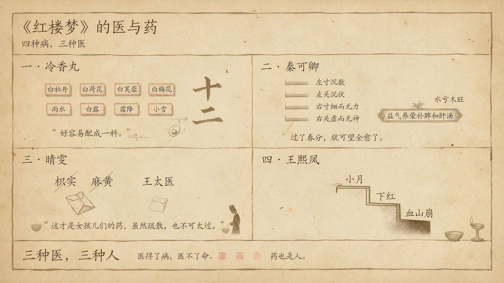

# 《红楼梦》的医与药

> 繁体版：[《红楼梦》的医与药](https://github.com/j3ffyang/history/blob/main/docs/261014-hlm-medical-zh-hant.md)

《红楼梦》里生老病死是家常。药与医，是书里暗暗铺开的另一条线。从一味要凑天时的冷香丸，到一次最精密的诊脉，再到一个少年替女孩儿挡下的狼虎药，这条线一直在走。

## 一、宝钗的冷香丸：要凑天时的药

第七回，宝钗跟周瑞家的说起自己的病。癞头和尚说她"从胎里带来的一股热毒"，给了一个海上方，叫冷香丸。

> 要春天开的白牡丹花蕊十二两，夏天开的白荷花蕊十二两，秋天的白芙蓉蕊十二两，冬天的白梅花蕊十二两。将这四样花蕊，于次年春分这日晒干，和在药末子一处，一齐研好。又要雨水这日的雨水十二钱──白露这日的露水十二钱，霜降这日的霜十二钱，小雪这日的雪十二钱。把这四样水调匀，和了药，再加十二钱蜂蜜，十二钱白糖，丸了龙眼大的丸子，盛在旧磁坛内，埋在花根底下。若发了病时，拿出来吃一丸，用十二分黄柏煎汤送下。（第七回）

方子不难懂，难的是凑齐。宝钗说，"一二年间可巧都得了，好容易配成一料"。这个"可巧"很要紧。四季的花，四个节气的水，缺一样都配不齐，要等天时正好凑在一起。

这味药是自然的，不是炉子里炼出来的。它不能买，只能等。所以冷香丸像一种时间的记号，记着一年四季，也记着一个人要过多少日子，才能把这一料凑齐。

## 二、秦可卿的病：最精密的一次诊断

第十回，尤氏跟别人说起秦可卿的病。

> 他这些日子不知怎么着，经期有两个多月没来。叫大夫瞧了，又说并不是喜。（第十回）

尤氏又说，请来的大夫都是"听着人的口气儿"，人怎么说，他也添几句文话儿说一遍。直到张友士来了，才有人真的看出问题。

> 这病就是打这个秉性上头思虑出来的。（第十回）

张友士诊完脉，说的是：

> 看得尊夫人这脉息：左寸沉数，左关沉伏，右寸细而无力，右关虚而无神。其左寸沉数者，乃心气虚而生火，左关沉伏者，乃肝家气滞血亏。右寸细而无力者，乃肺经气分太虚，右关虚而无神者，乃脾土被肝木克制。（第十回）

他断为"水亏木旺"，又说"这病尚有三分治得"。他开的方子是益气养荣补脾和肝汤。

> 益气养荣补脾和肝汤：人参二钱、白术二钱、土炒云苓三钱、熟地四钱、归身二钱、酒洗白芍二钱、炒川芎钱半、黄苓三钱、香附米二钱、制醋柴胡八分、怀山药二钱、炒真阿胶二钱、蛤粉炒延胡索钱半、酒炒炙甘草八分，引用建莲子七粒去心、红枣二枚。（第十回）

张友士还留了一句判语：

> 今年一冬是不相干的。总是过了春分，就可望全愈了。（第十回）

诊断很准，命却不准。"过了春分"的话，和秦可卿之后的结局，读起来是一个反讽。

### 方里有什么（读者分析）

张友士的方子，书里只列了药和分量，没有写每味药在方里做什么。下面的归类是读者的归纳，不是正文的说法。归类也不是逐条对照药典，只是把药按作用粗略分组：

| 归类 | 药 | 对应脉案所见 |
|---|---|---|
| 补气健脾 | 人参2钱、白术2钱、土炒云苓3钱、怀山药2钱、炙甘草8分 | 肺气太虚、脾土被肝木克制 |
| 养血 | 熟地4钱、归身2钱、酒洗白芍2钱、炒真阿胶2钱 | 肝家血亏 |
| 行气疏肝 | 制醋柴胡8分、香附米2钱、炒川芎1钱半、蛤粉炒延胡索1钱半 | 肝家气滞 |
| 清热 | 黄苓3钱 | 心气虚而生火 |
| 调和引导 | 炙甘草、建莲子7粒、红枣2枚 | 调和 |

从这张表可以看出几点。第一，方子的每一组药，都能在脉案里找到对应的病。第二，补药占的分量最多，熟地用了4钱，是一味药里分量最重的。第三，书里写明了炮制方法，如土炒、酒洗、醋制、酒炒，但每种炮制对药性有什么影响，书里没有说。

这些药和脉案的对应，是读者归纳出来的。书里没有说每味药是君、臣、佐、使，这里也只作参考。君臣佐使是中医方剂学的组方概念，见人民日报海外版的介绍，也见南京中医药大学学报的研究。

## 三、晴雯的药：谁替女儿家挡下狼虎药

第五十一回，回目是"胡庸医乱用虎狼药"。晴雯夜里受寒，请来一个生大夫。大夫的方子上有紫苏、桔梗、防风、荆芥，后面又有枳实、麻黄。宝玉看了，急了：

> 该死，该死，他拿着女孩儿们也象我们一样的治，如何使得！凭他有什么内滞，这枳实，麻黄如何禁得。（第五十一回）

后来另请王太医来看。王太医的方子里果然没有枳实、麻黄，药的分量也比先前轻了些。宝玉喜道：

> 这才是女孩儿们的药，虽然疏散，也不可太过。（第五十一回）

宝玉又说，自己小时候病了，大夫也说他"禁不起麻黄，石膏，枳实等狼虎药"，把女儿家比作"才开的白海棠"。他还说：

> 药气比一切的花香果子香都雅。（第五十一回）

正文写的是"狼虎药"，回目写的是"虎狼药"，两处并存，引用时要分清。

## 四、王熙凤的病：医不了的强人

王熙凤是全书最能干的人，她的病却一直拖着。第五十五回，她小产了：

> 刚将年事忙过，凤姐儿便小月了，在家一月，不能理事，天天两三个太医用药。（第五十五回）

她自恃强壯，还是要管事。一个月之后，又添了下红的症。

> 一月之后，复添了下红之症。他虽不肯说出来，众人看他面目黄瘦，便知失于调养。（第五十五回）

第七十二回，平儿跟鸳鸯说起凤姐的病，话里说她懒懒的已经有一个月了，又说凤姐不肯请大夫。鸳鸯一听，说"依你这话，这可不成了血山崩了"。这是丫鬟之间的私话，不是大夫的诊断。

> 他这懒懒的也不止今日了，这有一月之前便是这样。（第七十二回）

## 余论：三种医，三种人

下面这些是我的读法，不是书里的原话。

**三种医生。** 癞头和尚的冷香丸，是象征。张友士的脉案，是写实，精密到每一句脉象。胡大夫的一方狼虎药，是反讽：他治的是"人"，却照着男人的方子来治女儿家。

**医得了病，医不了命。** 冷香丸能压住热毒，却压不住命运。张友士断得准脉，却断不准生死。

**药也是人。** 宝玉替女孩儿挡下狼虎药的那一节，把"医"写成了体贴。

**王熙凤的病。** 她是全书最能干的人，却败在病上。小产，下红，一拖几个月，书里写的是她不肯停下来。

宝钗的冷香丸和本文的其他几例，也可以和《宝钗：药·冷·自然》对照着读。

## 引用来源

- 曹雪芹《红楼梦》第七回，维基文库：<https://zh.wikisource.org/wiki/%E7%B4%85%E6%A8%93%E5%A4%A2/%E7%AC%AC007%E5%9B%9E>
- 曹雪芹《红楼梦》第十回，维基文库：<https://zh.wikisource.org/wiki/%E7%B4%85%E6%A8%93%E5%A4%A2/%E7%AC%AC010%E5%9B%9E>
- 曹雪芹《红楼梦》第五十一回，维基文库：<https://zh.wikisource.org/wiki/%E7%B4%85%E6%A8%93%E5%A4%A2/%E7%AC%AC051%E5%9B%9E>
- 曹雪芹《红楼梦》第五十五回，维基文库：<https://zh.wikisource.org/wiki/%E7%B4%85%E6%A8%93%E5%A4%A2/%E7%AC%AC055%E5%9B%9E>
- 曹雪芹《红楼梦》第七十二回，维基文库：<https://zh.wikisource.org/wiki/%E7%B4%85%E6%A8%93%E5%A4%A2/%E7%AC%AC072%E5%9B%9E>
- 《君臣佐使》相关介绍，人民日报海外版，2016年4月8日：<http://paper.people.com.cn/rmrbhwb/html/2016-04/08/content_1668619.htm>
- 李飞《方剂君臣佐使中的君药辨析》，南京中医药大学学报，2021：<https://xb.njucm.edu.cn/article/doi/10.14148/j.issn.1672-0482.2021.0481>
