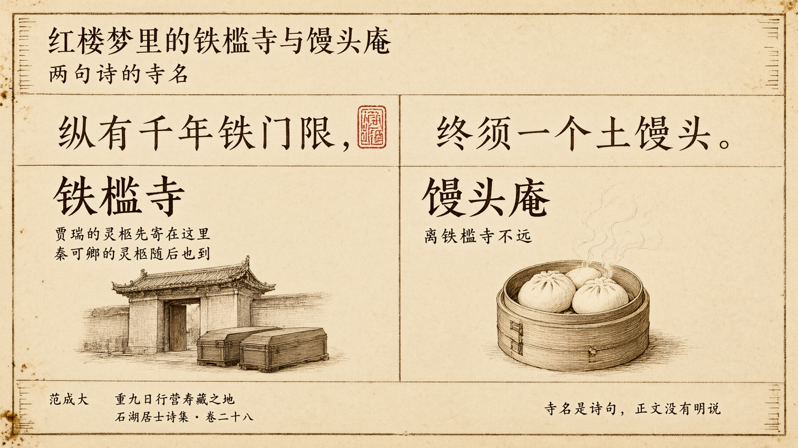

# 红楼梦里的铁槛寺与馒头庵：两句诗的寺名

> 繁体版：[红楼梦里的铁槛寺与馒头庵：两句诗的寺名](https://github.com/j3ffyang/history/blob/main/docs/261020-hlm-tiekan-mantou-zh-hant.md)

## 一、贾瑞的灵柩

读者通常觉得贾瑞令人讨厌，死时也很龌龊。他死后，灵柩寄在了铁槛寺。

> 当下，代儒料理丧事，各处去报丧。三日起经，七日发引，寄灵于铁槛寺，日后带回原籍。（第十二回）

> 脂批（庚辰本，双行夹批，第十二回）：所谓"铁门限"事业。先安一开路道之人，以备秦氏仙柩有方也。

脂批把贾瑞的寄灵，和秦氏的灵柩连在了一起。铁槛寺，先为秦氏"开路"。这是脂批的说法，正文没有直接写。

铁槛寺原是宁荣二公当日修造的，以备京中老了人口，在此便宜寄放灵柩。第十五回说得很清楚：

> 原来这铁槛寺原是宁荣二公当日修造，现今还是有香火地亩布施，以备京中老了人口，在此便宜寄放。其中阴阳两宅俱已预备妥贴，好为送灵人口寄居。（第十五回）

## 二、秦可卿也到了铁槛寺

书里写秦可卿"生的袅娜纤巧，行事又温柔和平"，是"重孙媳中第一个得意之人"（第五回）。她死后的葬礼庞大隆重，灵柩也到了铁槛寺。第十四回，贾珍先去看寄灵的地方：

> 那贾珍因见发引日近。亲自坐车，带了阴阳司吏，往铁槛寺来踏看寄灵所在。（第十四回）
>
> 一面又派人先往铁槛寺，连夜另外修饰停灵之处，并厨茶等项接灵人口坐落。（第十四回）

第十五回，送殡的队伍出城，直奔铁槛寺：

> 且说宁府送殡，一路热闹非常。……然后出城，竟奔铁槛寺大路行来。（第十五回）

## 三、诗词来源

第十五回，王熙凤安排住处的地方，是馒头庵。正文说：

> 原来这馒头庵就是水月庵，因他庙里做的馒头好，就起了这个浑号，离铁槛寺不远。（第十五回）

甲戌本在这一句下有一条双行夹批：

> 脂批（甲戌本，双行夹批，第十五回）：前人诗云："纵有千年铁门限，终须一个土馒头。"是此意。故"不远"二字有文章。

这样，两个寺名就都对上了：铁槛寺的"铁槛"，即批语所谓"铁门限"；馒头庵的"馒头"，即"土馒头"。两句诗，正好做了两座寺的名字。这是批语点出的读法，正文没有明说。

脂批说的"前人"，没有写出名字。我们查到这两句诗的原作者是宋代范成大。范成大号石湖居士，《石湖居士诗集》卷二十八收有《重九日行营寿藏之地》，诗中这两句是：

> 家山随处可行楸，荷锸携壶似醉刘。纵有千年铁门限，终须一个土馒头。三轮世界犹灰劫，四大形骸强首丘。蝼蚁乌鸢何厚薄，临风拊掌菊花秋。（《石湖居士诗集》卷二十八）

《红楼梦》正文里，妙玉也常引这两句。第六十三回，是邢岫烟向宝玉转述她的话：

> 他常说："古人自汉晋五代唐宋以来皆无好诗，只有两句好，说道：'纵有千年铁门槛，终须一个土馒头。'所以他自称'槛外之人'。"（第六十三回）

这两句在书里出现两次：一次是第十五回的脂批，一次是第六十三回的正文（邢岫烟转述妙玉的话）。第六十三回作"门槛"，脂批与诗集作"门限"，用字不同；本文都照原文引用，不改字。

## 引用来源

- 曹雪芹《红楼梦》第五回，维基文库：<https://zh.wikisource.org/wiki/%E7%B4%85%E6%A8%93%E5%A4%A2/%E7%AC%AC005%E5%9B%9E>
- 曹雪芹《红楼梦》第十二回，维基文库：<https://zh.wikisource.org/wiki/%E7%B4%85%E6%A8%93%E5%A4%A2/%E7%AC%AC012%E5%9B%9E>
- 曹雪芹《红楼梦》第十四回，维基文库：<https://zh.wikisource.org/wiki/%E7%B4%85%E6%A8%93%E5%A4%A2/%E7%AC%AC014%E5%9B%9E>
- 曹雪芹《红楼梦》第十五回，维基文库：<https://zh.wikisource.org/wiki/%E7%B4%85%E6%A8%93%E5%A4%A2/%E7%AC%AC015%E5%9B%9E>
- 曹雪芹《红楼梦》第六十三回，维基文库：<https://zh.wikisource.org/wiki/%E7%B4%85%E6%A8%93%E5%A4%A2/%E7%AC%AC063%E5%9B%9E>
- 脂砚斋评《脂砚斋重评石头记》第十二回（庚辰本），维基文库：<https://zh.wikisource.org/wiki/%E8%84%82%E7%A1%AF%E9%BD%8B%E9%87%8D%E8%A9%95%E7%9F%B3%E9%A0%AD%E8%A8%98/%E7%AC%AC%E5%8D%81%E4%BA%8C%E5%9B%9E>
- 脂砚斋评《脂砚斋重评石头记》第十五回（甲戌本），维基文库：<https://zh.wikisource.org/wiki/%E8%84%82%E7%A1%AF%E9%BD%8B%E9%87%8D%E8%A9%95%E7%9F%B3%E9%A0%AD%E8%A8%98/%E7%AC%AC%E5%8D%81%E4%BA%94%E5%9B%9E>
- 范成大《石湖居士诗集》卷二十八（四部丛刊本），维基文库：<https://zh.wikisource.org/wiki/%E7%9F%B3%E6%B9%96%E5%B1%85%E5%A3%AB%E8%A9%A9%E9%9B%86_%28%E5%9B%9B%E9%83%A8%E5%8F%A2%E5%88%8A%E6%9C%AC%29/%E5%8D%B7%E7%AC%AC%E4%BA%8C%E5%8D%81%E5%85%AB>

> 版本说明：引文据维基文库转录的《红楼梦》（脂本系统、程乙本）与《脂砚斋重评石头记》脂批，只作繁简转写，异体字随文统一（如"箇"作"个"、"刦"作"劫"）；脂批的版本归属依维基文库页面标注，未核影印本。底本另有异文者，随文注出。

本文是听蒋勋《蒋勋细说红楼梦》之后的感想记录。
