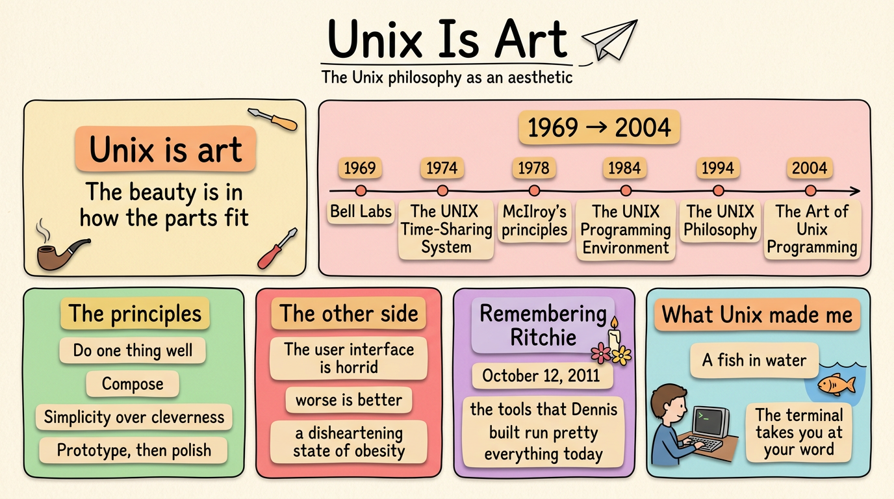

The Unix philosophy is not a specification. No committee ratified it, and no standard defines it — POSIX standardizes the calls, not the taste. It is a set of cultural norms — a folk tradition of software design — that grew up around one operating system at Bell Labs and then outlived it. **Eric S. Raymond**'s book on the subject is even titled *The Art of Unix Programming*, and that word is the point: the philosophy is passed down as craft, by example and habit, the way a workshop teaches how a thing is made. This is its story, from the late 1960s to 2004 and beyond: the ideas that tie it together.

## History

It started as a constraint. In 1969–70 at Bell Labs, **Ken Thompson** and **Dennis Ritchie** built an operating system on a small machine with a slow printing terminal — and the machine's limits became its style. As **Raymond** puts it, the philosophy "originated with **Ken Thompson**'s early meditations on how to design a small but capable operating system with a clean service interface." Small wasn't a preference. It was the budget.

**Ritchie** and **Thompson** wrote the design considerations down in their 1974 paper, "The UNIX Time-Sharing System," in *Communications of the ACM*, and they read like a creed born of scarcity: make it easy to write, test, and run programs; prefer interactive use to batch processing; chase economy and elegance *because of* size constraints — to borrow a phrase, "salvation through suffering"; and keep the system self-supporting, with all Unix software maintained under Unix.

By 1978 the style had a spokesman. **Doug McIlroy** — the man who invented the Unix pipe — simply recorded what everyone around him was already doing, in the foreword to the *Bell System Technical Journal*'s Unix issue: make each program do one thing well, and build afresh rather than bolt features onto an old tool; expect every program's output to become the input to another, as-yet-unknown program. Build software to be tried early, ideally within weeks, and don't hesitate to throw away the clumsy parts; and reach for tools over unskilled help, even if you have to build the tools yourself. He later squeezed the whole thing into one sentence I've repeated for thirty years: *write programs that do one thing and do it well; write programs to work together; write programs to handle text streams, because that is a universal interface.*

In 1984 the philosophy became literature. **Brian Kernighan** and **Rob Pike**'s *The UNIX Programming Environment* described it outright — what makes Unix effective "is the approach to programming, a philosophy of using the computer … the power of a system comes more from the relationships among programs than from the programs themselves" — and held up `cat` as the archetype of a tool that does one general thing well, while pointing at the newer systems, 4.2BSD and System V, as the ones piling on options.

A decade later, in 1994, the name stuck for good: **Peter Salus** credited **McIlroy** with "the Unix philosophy" in *A Quarter Century of Unix*, and the next year **Mike Gancarz**'s *The UNIX Philosophy* boiled it down to nine major tenets — "small is beautiful," "store data in flat text files," "make every program a filter."

Then, in 2003–2004, **Eric S. Raymond**'s *The Art of Unix Programming* gave it the form I keep coming back to — "Keep It Simple, Stupid" — and seventeen rules, from the Rule of Modularity ("write simple parts connected by clean interfaces") to the Rule of Extensibility ("design for the future, because it will be here sooner than you think"). More than the rules, though, he named what had been implicit all along: the philosophy is bottom-up, not top-down; pragmatic and grounded in experience; found not in official standards but in the "implicit half-reflexive knowledge, the expertise that the Unix culture transmits."

AT&T kept Unix proprietary, but the design escaped anyway: Linux reimplemented the interface from scratch, GNU supplied the tools and the license, and by the turn of the century the architecture Unix had drawn was free in a way its code never was. That is what outlived it — the shape, not the source.

## Philosophy

Strip away the dates and the same handful of ideas keep coming back — the ones that, over the years, stopped being rules I read and became habits I have.

- **Do one thing well.** The rule the community later abbreviated as DOTADIW: small programs, each doing one job, beat one big program doing many. Build afresh rather than bolt features onto an old tool. This is the one I break most, and regret most.
- **Compose.** Expect every program's output to become another's input. Text streams are the universal interface — to Unix tools what messages are to objects in an object-oriented setting, as **Raymond** put it.
- **Simplicity over cleverness.** Clarity beats cleverness; add complexity only where you must. **McIlroy** again: the notion of "intricate and beautiful complexities" is almost an oxymoron.
- **Separate policy from mechanism.** Keep interfaces apart from engines, so each can change on its own timescale.
- **Prototype, then polish.** Get it working before you optimize it — **Knuth**'s "premature optimization is the root of all evil," or **Thompson**'s blunter "when in doubt, use brute force."
- **Fail loudly; stay silent otherwise.** When a program has nothing surprising to say, it should say nothing; when it must fail, it should fail noisily and soon.
- **Data over code.** Fold knowledge into data so the program logic can be stupid and robust.

**Rob Pike** added his own rules in *Notes on C Programming*, ending with the famous non-rule: "Rule 6. There is no Rule 6." And **Richard Gabriel** gave the philosophy its most uncomfortable corollary — *worse is better* — the claim that simplicity of interface and implementation matters more than correctness, consistency, or completeness.

## The other side

No philosophy is free of cost, and this one has drawn real criticism.

**Don Norman**, in a 1981 *Datamation* piece titled "The truth about Unix: the user interface is horrid," argued that the philosophy's indifference to the end user's cognitive model makes disastrous mistakes easy. That is a complaint about friendliness, not honesty — and Unix never promised to be friendly. More recently, game developer **Jonathan Blow** called the philosophy outdated, comparing its chained tools to microservices — architectures that turn inefficient without overall supervision.

And the culture polices itself. **McIlroy**, looking at modern Linux, complained that "adoring admirers have fed Linux goodies to a disheartening state of obesity" — a direct violation of **Raymond**'s Rule of Parsimony, which says to write a big program only when nothing else will do. The philosophy is not a settled doctrine; it is an argument the Unix community keeps having with itself.

## Why art

**Raymond** called it *art* rather than *method*. **Kernighan** and **Pike** had given the reason in 1984: "that philosophy can't be written down in a single sentence." What can be written down is a style — a way of making things — and a style is learned, not specified. The philosophy lives in the tools themselves: the pipe that makes two programs one, the filter that reads a text stream and writes another, the small command that does one thing and does it well.

Unix is art in the same sense a good tool is: the beauty is not in any single part but in how the parts fit. As **Kernighan** and **Pike** put it: "Many UNIX programs do quite trivial things in isolation, but, combined with other programs, become general and useful tools." That is the whole idea — and it is why the same philosophy, more than half a century on, still shows up everywhere, from the shell to a modern agent's toolbox of small, composable skills.

## Remembering Ritchie

**Dennis Ritchie** died on October 12, 2011, at his home in Berkeley Heights, New Jersey. He was 70. One week earlier, **Steve Jobs** had died — and the world stopped for **Jobs** while **Ritchie**'s death barely registered outside the trade press. That asymmetry is worth sitting with.

**Jobs** sold the future; **Ritchie** built the ground it runs on. **Ritchie co-created Unix and created the C language** — the language at the kernel and core of Unix, Linux, macOS, and Windows, and the ancestor of C++, Objective-C, Java, and C#. As **Brian Kernighan** put it, "the tools that **Dennis** built — and their direct descendants — run pretty much everything today." The computer historian **Paul Ceruzzi** said it better: "if you had a microscope and could look in a computer, you'd see his work everywhere inside."

It is no slight to **Jobs** to say **Ritchie**'s reach was deeper. One made the products we carry; the other made the layer everything else is built on. When **Ritchie** died, Fedora 16 and FreeBSD 9.0 were both dedicated to his memory, and an asteroid was named for him. The notice was quiet. The work is not.

We remember him.

## For fun and for pain

Two memories from the terminal — one for fun, one for pain.

The first was pure power. I once ran `dd` against `/dev/sda1` on my personal Linux machine and wiped the root partition clean. The system didn't even flinch: it kept running, alive in memory, as if nothing had happened — but underneath it there was nothing left. The moment I powered down, it was gone. One command, total and immediate, with no undo. That is the terminal: it does exactly what you tell it.

The second was comfort turning on me. I had flown to the US to work at the IBM software lab, jet-lagged, and after giving a talk I wanted to shut down my own laptop — the one I'd used for the presentation — so I typed `sudo shutdown -h now` into a terminal. The terminal went dark; my machine did not. That is when I understood: the terminal I had typed into was not mine — it was the lab's DNS server for 6,000 virtual machines on about 200 servers. I had opened that session earlier for a demo — an SSH window in Terminator — and I still can't remember why a demo needed a DNS server. It got worse. The server was run by a smart — sometimes lazy — engineer who had applied a patch without rebooting, so it didn't come back up cleanly. I called the administrator at five in the morning — my mistake, her morning — and by ten it was resolving names again, just ahead of the day's load.

Both stories are one lesson from two directions: the terminal takes you at your word. Nothing stands between the thought and the consequence, which is why it is so fast, and why it can hurt. And I love working in a terminal, which is exactly the problem: they all look the same — a black screen, a green cursor blinking — and for one second you forget which machine you are talking to.

## What Unix made me

I never set out to adopt a philosophy. I set out to use a computer, and the Unix way of doing things settled into me until it was less a tool than a temperament.

- **Minimalism as a value, not a preference.** I am a minimalist and I hate bloatware; I chose Arch for its minimal install, not in spite of it. The terminal starts from almost nothing and grows only with what you add.
- **The philosophy is the aesthetic.** "Do one thing and do it well" is not only an engineering rule — it is an aesthetic one. A pipe chain is a small composition, honest pieces combined into something greater than any of them. That is why I call it art.
- **Transparency over black boxes.** When a GUI broke, I was lost; when the terminal broke, I could read the error and fix it. The machine stopped being a black box — files, processes, pipes, permissions learned by looking, not by clicking.
- **Composable, durable artifacts.** A GUI workflow lives in muscle memory and dies with your patience; a terminal workflow lives in a file and lasts forever. My notes have lived in one plain-text place, retrievable from the command line, since 2000.
- **Free, in the design.** Unix's source was owned; its soul was not. Your data is text, your tools are files, your workflow is a script, and the machine can be rebuilt from parts you can name. No hostage format, no castle gate that only the owner can open. A free soul, not a free download.
- **Honest, and it shows its work.** The system does what it is told, and afterwards you can read exactly what it did: the effect traces to a file, a script, a line you typed. You get what you build, and you own it — including the disk you just erased. No friendly layer, no hidden agent quietly reinterpreting you. When it surprises you, the surprise was yours; the machine never lied, it only took you at your word.
- **Stability over novelty.** A command I type today would work on a system from 1975; the most reliable interface in computing is also the oldest. I am drawn to the small, well-designed thing that outlasts the shiny one.
- **Craft over celebrity.** The deepest thread — I revere the builder over the product-maker: the quiet foundation over the bright surface.
- **Habits over rescues.** Security became a habit, not a one-time fix — small, robust, composable defenses, done once and kept.
- **In my element.** When I touch a Unix or Linux terminal, I feel like a fish in water — not a tool I use, but the water I move in.

Almost thirty years, AIX to Arch, and it comes down to this: Unix did not just teach me how to use a computer; it gave me a way to think — minimalist, transparent, free, honest, composable, long-lived, craft-first — and then let me see that way as art. I have told parts of this story before, in [`260811-terminal-is-an-art.md`](https://github.com/j3ffyang/ai-thoughts/blob/main/docs/260811-terminal-is-an-art.md) and [`260828-happy-birthday-linux-from-aix-to-arch.md`](https://github.com/j3ffyang/ai-thoughts/blob/main/docs/260828-happy-birthday-linux-from-aix-to-arch.md). `btw, i use arch` is not a joke; it is the whole argument in four words.

## Sources

- Dennis M. Ritchie and Ken Thompson, "The UNIX Time-Sharing System," *Communications of the ACM* 17 (7), July 1974 — <https://cs.nyu.edu/~mwalfish/classes/ut/f09-cs395t/ref/ritchie74.pdf>
- M. D. McIlroy, E. N. Pinson, and B. A. Tague, "Unix Time-Sharing System: Foreword," *The Bell System Technical Journal* 57 (6), July–August 1978, pp. 1902–1903
- Donald A. Norman, "The truth about Unix: the user interface is horrid," *Datamation* 27 (12), 1981
- Brian W. Kernighan and Rob Pike, *The UNIX Programming Environment*, Prentice-Hall, 1984 — <https://www.cs.princeton.edu/~bwk/upe/upe.html>
- Rob Pike and Brian W. Kernighan, "Program Design in the UNIX Environment," *AT&T Bell Laboratories Technical Journal* 63 (8), October 1984
- Rob Pike, "Notes on Programming in C," 1989
- Richard P. Gabriel, "Lisp: Good News, Bad News, How to Win Big," 1991
- Peter H. Salus, *A Quarter Century of Unix*, Addison-Wesley, 1994
- Mike Gancarz, *The UNIX Philosophy*, Digital Press, 1995
- Eric S. Raymond, *The Art of Unix Programming*, ch. 1.6, "Basics of the Unix Philosophy" — <http://www.catb.org/esr/writings/taoup/html/ch01s06.html>
- Jonathan Blow, interview, *On the Metal* podcast
- Wikipedia, *Unix philosophy* — <https://en.wikipedia.org/wiki/Unix_philosophy>
- Wikipedia, *Dennis Ritchie* — <https://en.wikipedia.org/wiki/Dennis_Ritchie>

btw, i use arch
