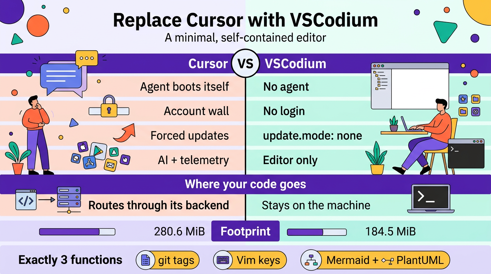

**Goal:** an editor that does 3 things and little else, self-contained, deletable in one step.

**Verdict:** VSCodium AppImage + a minimal Open VSX extension set covers all 3 functions with zero pacman/AUR additions, no account, and no forced agent panel. Chosen over a system package for the "delete it and it's gone" model.

**The 3 things it must do:** (1) a file tree with **git status tags**; (2) view/edit **source with Vim keys**; (3) **render Markdown with Mermaid + PlantUML diagrams**. Everything else is deliberately out of scope — details are in "Mapping the 3 functions to tools" below.



## Why leave Cursor

The two things I dislike most, and everything else is downstream of them:

1. **Forced agent on launch** — the agent is Cursor's centre of gravity, so it opens itself; there is no "editor only" default landing state.
2. **Telemetry & privacy exposure** — the editor is a data path by design (expanded in the next section).

| Grievance | Cursor behaviour | VSCodium behaviour |
|---|---|---|
| Forced agent on launch | Chat/agent pane opens itself | No agent; you launch **OpenCode** yourself in your own terminal (Kitty), outside VSCodium |
| Account / sign-in gate | Account wall to reach the AI-native editor | **No login** to launch, edit, or install extensions |
| Lock-in to one vendor's agent | Built-in, replaceable only via workarounds | Core OSS is agent-agnostic; OpenCode is just a TUI in your own terminal |
| Update nagging | Frequent, forced upgrade prompts | `update.mode: none`; the AppImage updates only when **you** replace the file |
| Feature bloat / condescension | Accounts, AI, telemetry, tip popups | Strip to editor + tree + preview via `settings.json` |

## Telemetry & end-user privacy

The structural difference: **Cursor's editor _is_ a data path; VSCodium's editor is not.**

### VSCodium — telemetry crippled at build time, and its settings off by default

Slightly weaker than "removed," and VSCodium says so itself: they *"do not pass the telemetry build flags and go out of our way to cripple the baked-in telemetry,"* but warn that *"Microsoft still can track usage by default depending on your settings."* The guarantee is a build without the MS telemetry flags **plus** these preferences, which VSCodium ships **off by default** (per its `docs/telemetry.md`):

```
telemetry.telemetryLevel
telemetry.enableCrashReporter
telemetry.enableTelemetry
telemetry.editStats.enabled
workbench.enableExperiments
workbench.settings.enableNaturalLanguageSearch
workbench.commandPalette.experimental.enableNaturalLanguageSearch
```

Microsoft's *online services* are **replaced**, not merely disabled:

- **Update check** → `updateUrl` is repointed at the project's GitHub page, and on **Linux the app update service is disabled at build time** regardless of `update.mode`.
- **Extension gallery** → replaced by **Open VSX** (Eclipse Foundation); no Microsoft marketplace calls.
- **Welcome page** announcements are fetched from GitHub (`workbench.welcomePage.extraAnnouncements: false` to stop it).
- The malicious/deprecated-extension list is fetched from an EclipseFdn URL (`extensions.excludeUnsafes: false` to stop it, at a safety cost).

Remaining network surface is the extension-control list fetch above, plus (a) opt-in metadata and (b) whatever the extensions themselves do. PlantUML renders **locally** here — MPE's builtin `plantuml.jar` + system `java`, no server — but two honest caveats: **VSCodium can't police extension telemetry** (some extensions, e.g. Microsoft's C#, phone home, and that is the author's choice), and **MPE's preview webview can fetch assets from `cdn.jsdelivr.net`** (a fetch for JS/CSS, not code egress). Audit what actually connects:

```sh
# while VSCodium is idle, expect zero established connections
ss -tpn | grep -i codium
# or, per-socket, watch during extension install
lsof -i -a -c VSCodium
```

No account either: VSCodium never asks you to log in to launch, edit, or install extensions — *"An account authentication occurs only when an extension is asking for it"* (`docs/accounts-authentication.md`). Its only sign-in is opt-in and token-based (`Sign in with GitHub`, needed only when an extension like GitLens requires it): no account wall, unlike Cursor's launch flow.

### Cursor — AI-first, so all traffic routes through its backend by design

From Cursor's own *Data Use & Privacy Overview* (updated 2026-09-03):

- **Privacy Mode off (a toggle, not the floor):** *"we may use and store codebase data, prompts, editor actions, code snippets … to improve our AI features and train our models."* With it on, training stops (zero-data-retention agreements with providers) — but risk/abuse classifiers may still run and, if triggered, *"your data may be stored for investigation."*
- **Your own API key does not bypass them:** *"Even if you use your API key, your requests will still go through our backend! That's where we do our final prompt building."*
- **File contents are cached on Cursor's servers** (encrypted, transient) to cut latency, and the client calls Cursor backend domains for API, update, and marketplace.

You can opt out of *training* with Privacy Mode, but you cannot opt out of *routing* — the editor and the agent are one product, and the product is the backend.

### Net effect

| | Where code goes | When | To whom |
|---|---|---|---|
| **Cursor** | Cursor backend, by design | On normal editor/agent use | Cursor, then their model subprocessors |
| **VSCodium + OpenCode** | Off the machine *only* when you invoke the agent | When you run OpenCode | The provider *you* configured, under *that* provider's terms |

So dropping Cursor removes a standing data path you don't control; with VSCodium the editor is inert and the only egress is OpenCode, invoked deliberately against a provider you chose.

## Mapping the 3 functions to tools

1. **File navigator with git status tags** → Explorer + the **bundled** `git` extension (`git.decorations.enabled`). No extra dependency — `git` is already installed.
2. **View / edit source, including Markdown** → built-in editor + Markdown grammar, driven by **Vim** keys (`vscodevim.vim`).
3. **Markdown rendering + mermaid + plantuml diagrams** → **Mermaid is built into the default preview** (shipped as the built-in `mermaid-markdown-features` extension); **PlantUML** comes from **Markdown Preview Enhanced** (`shd101wyy.markdown-preview-enhanced`), rendered **locally** via its builtin `plantuml.jar` + system `java`. MPE renders Mermaid too, so either preview works — the settings notes below cover the one MPE default that otherwise hides the built-in preview buttons.

## Verified environment (read-only checks)

| Fact | Value |
|---|---|
| FUSE (AppImage runtime) | `fuse2 2.9.9-6`, `fuse3 3.18.3-1`, `/usr/bin/fusermount{3}` setuid — present |
| Existing Cursor | AppImage no longer present; only config remains (see Footprint) |
| `git` | `2.56.0` |
| Diagram deps | `graphviz` present, `jre-openjdk 27` present, `~/pool/Downloads/rog_drive/plantuml.jar` present |
| OpenCode | `1.19.0` at `~/.opencode/bin/opencode` |
| Latest VSCodium | `1.140.06880` (`x86_64` AppImage published on GitHub releases) |

## Install — AppImage, checksum verified

Non-root, no pacman. AppImage lives outside the system package DB; removing it leaves no footprint except the config dir. Chosen over the AUR `vscodium-bin` / `extra/code` (drag in pacman deps) and Flatpak (drags in a whole runtime) precisely for that: self-contained and delete-and-go.

```sh
mkdir -p ~/.local/bin
cd ~/.local/bin

VER=1.140.06880
BASE=https://github.com/VSCodium/vscodium/releases/download/$VER
curl -fLO "$BASE/VSCodium-$VER-anylinux-x86_64.AppImage"
curl -fLO "$BASE/VSCodium-$VER-anylinux-x86_64.AppImage.sha256"

sha256sum -c "VSCodium-$VER-anylinux-x86_64.AppImage.sha256"

chmod +x "VSCodium-$VER-anylinux-x86_64.AppImage"
ln -sf "VSCodium-$VER-anylinux-x86_64.AppImage" VSCodium.AppImage   # stable name, survives version bumps
```

**Note:** AppImage `anylinux` builds work as-is on Arch's glibc; if one ever fails to self-mount, run it with `--appimage-extract-and-run` (no FUSE needed). FUSE is present here, so not expected.

**Updating:** download the new AppImage and re-point `VSCodium.AppImage` at it (`ln -sf "VSCodium-$VER-anylinux-x86_64.AppImage" VSCodium.AppImage`); nothing self-updates, and extensions refresh only on demand.

## Extensions (Open VSX, no Microsoft account)

Open VSX is the Eclipse Foundation's vendor-neutral extension **registry** — the free stand-in for Microsoft's Visual Studio Marketplace, which is licensed for official VS Code only (so OSS builds like VSCodium can't use it). VSCodium's gallery points at it by default, so no marketplace flag or Microsoft account is required. The set is deliberately **three** — nothing the built-in core already does is re-added. Install counts are pulled from the Open VSX API (re-check any of them, e.g. `curl -s https://open-vsx.org/api/shd101wyy/markdown-preview-enhanced | jq .downloadCount`):

| Function | Extension (ID) | Version | Open VSX installs |
|---|---|---|---|
| **Vim keys** (primary editing mode) | `vscodevim.vim` | 1.32.4 | 1,956,779 |
| **Markdown preview + PlantUML** (own preview; also covers Mermaid) | `shd101wyy.markdown-preview-enhanced` | 0.8.40 | 2,437,299 |
| **Markdown → PDF** (optional) | `yzane.markdown-pdf` | 2.2.0 | 255,423 |

```sh
V=~/.local/bin/VSCodium.AppImage

$V --install-extension vscodevim.vim
$V --install-extension shd101wyy.markdown-preview-enhanced
$V --install-extension yzane.markdown-pdf
```

- **Vim** (`vscodevim.vim`) emulates Vim in-process; `useNeovim` is off by default, so **no system `vim`/`neovim` dependency** is added.
- **Markdown PDF** (`yzane.markdown-pdf`) is an add-on beyond the three functions (export only); it renders through a **Chromium via `puppeteer-core`**, not the editor's Electron.
- **Mermaid is built in — no extension needed.** VSCodium ships a built-in `mermaid-markdown-features` extension (verified inside the AppImage), so the default preview renders a `mermaid` fenced block out of the box. `bierner.markdown-mermaid` was therefore dropped.
- **PlantUML via MPE, rendered locally.** MPE renders it **on-machine** through a bundled `plantuml.jar` + your `jre-openjdk 27`, with no server. This replaces `jebbs.plantuml`, which was dropped.
- **CDN caveat (honest):** MPE's preview webview can load libraries from `jsdelivrCdnHost` (default `cdn.jsdelivr.net`) — a network *fetch for assets* when previewing, not code egress. For a fully offline preview you would have to vendor those assets; otherwise expect CDN calls.

## Minimal `settings.json`

Write to `~/.config/VSCodium/User/settings.json` — nothing touches `~/.config/Cursor/`. Everything else stays at defaults.

```json
{
  "update.mode": "none",
  "extensions.autoCheckUpdates": false,
  "extensions.autoUpdate": false,
  "telemetry.telemetryLevel": "off",
  "telemetry.feedback.enabled": false,
  "workbench.startupEditor": "none",
  "workbench.tips.enabled": false,
  "workbench.enableExperiments": false,
  "workbench.welcomePage.extraAnnouncements": false,
  "workbench.settings.enableNaturalLanguageSearch": false,
  "workbench.commandPalette.experimental.enableNaturalLanguageSearch": false,
  "window.restoreWindows": "none",
  "editor.minimap.enabled": false,
  "git.enabled": true,
  "git.decorations.enabled": true,
  "vim.useSystemClipboard": true,
  "markdown-pdf.executablePath": "/usr/bin/chromium",
  "markdown-preview-enhanced.plantumlServer": "",
  "markdown-preview-enhanced.plantumlJarPath": "/home/jeff/pool/Downloads/rog_drive/plantuml.jar",
  "markdown-preview-enhanced.hideDefaultVSCodeMarkdownPreviewButtons": false
}
```

- `git.decorations.enabled` gives the file-tree **tags** requested in function (1) — one letter per status (`M`/`A`/`U`), coloured, with no extra extension.
- `window.restoreWindows: none` + `workbench.startupEditor: none` pin the landing state to Explorer + editor, so nothing (no agent pane, no restored panel) ever auto-opens.
- `vim.useSystemClipboard` shares the system clipboard with Vim mode.
- The MPE keys keep PlantUML local: empty `plantumlServer` = use the builtin jar, whose own description says *"`java` is required in system path"*; `plantumlJarPath` points at your own jar (drop it to use MPE's bundled one); `hideDefaultVSCodeMarkdownPreviewButtons: false` keeps the built-in preview's button next to MPE's (its default `true` hides it).
- `markdown-pdf.executablePath` pins the PDF exporter to the system Chromium, so `puppeteer-core` never auto-downloads Chrome.
- The telemetry keys match VSCodium's privacy defaults, except `telemetry.feedback.enabled` and `workbench.welcomePage.extraAnnouncements`, which VSCodium leaves on. The rest are deliberate departures from upstream defaults: `update.mode`, the two extension-update keys, `workbench.startupEditor`, `workbench.tips.enabled`, `window.restoreWindows`, `editor.minimap.enabled`, `vim.useSystemClipboard`, `markdown-pdf.executablePath`, `plantumlJarPath`, and `hideDefaultVSCodeMarkdownPreviewButtons`. Listing them makes the intent explicit and survives a settings import.

## OpenCode outside the editor

No extension, no integration. Run OpenCode in your own terminal emulator — here, **Kitty**, completely outside VSCodium:

```
opencode
```

VSCodium never opens an agent pane on its own, and OpenCode never runs inside it. This is the whole point of dropping Cursor: the editor and the agent are separate processes.

## Optional — launcher entry and `$PATH`

Only if you want a menu/keybind launch. `~/.local/share/applications/VSCodium.desktop`:

```ini
[Desktop Entry]
Type=Application
Name=VSCodium
Exec=/home/jeff/.local/bin/VSCodium.AppImage %F
Terminal=false
Categories=Utility;TextEditor;Development;
MimeType=text/plain;text/markdown;inode/directory;
```

The AppImage installs no icon, so omit `Icon=` (as above) or extract the real one with `$V --appimage-extract 'code.svg'` — the icon is `code.svg` (also `.DirIcon`), and `*.png` pulls 170+ unrelated UI icons, not the app icon. Point `Icon=` at the extracted SVG. For shell use: `ln -s "$V" ~/.local/bin/codium`.

## What this is NOT (honest tradeoff)

- **It is still Electron — and the win is behaviour, not size.** Extracted on disk ≈ **795 MiB** (`du`), ~10 processes — not a Unix-frugal program. VSCodium is *Cursor minus the AI, telemetry, update server, and forced agent*: the AppImage is only ~34% smaller than Cursor's, and the extracted tree is the real cost (see Footprint below).
- **If Electron ever grates,** the terminal-native fallback is `nvim` + `gitsigns`/`neo-tree` + `render-markdown.nvim` + `plantuml.jar` — lighter, but N plugins and no browser-grade preview.

### Footprint

| Artifact | Bytes | MiB |
|---|---:|---:|
| Cursor AppImage (before removal) | 294,255,096 | 280.6 |
| VSCodium AppImage | 193,460,378 | 184.5 |
| VSCodium extracted on disk (`du`) | 833,792,301 | 795.2 |
| Cursor config left behind (`~/.config/Cursor` + `~/.cursor`) | — | ≈ 825 |

## Rollback / uninstall

Everything is contained:

```sh
rm -f ~/.local/bin/VSCodium.AppImage ~/.local/bin/VSCodium-*.AppImage*
rm -rf ~/.config/VSCodium ~/.vscode-oss ~/.cache/VSCodium ~/.local/share/VSCodium
rm -f ~/.local/bin/codium ~/.local/share/applications/VSCodium.desktop
```

No pacman packages were added; nothing else references it.

### If you are also retiring Cursor (manual)

Cursor is removed by hand and is **separate from the VSCodium uninstall**. Delete the app and any launcher, then the profile it leaves behind (see Footprint):

```sh
# adjust the AppImage path to wherever you kept Cursor
rm -f ~/Downloads/Cursor-*.AppImage ~/.local/bin/cursor ~/.local/share/applications/cursor.desktop
rm -rf ~/.config/Cursor ~/.cursor
ls -d ~/.config/Cursor ~/.cursor 2>/dev/null || echo "Cursor purged"
```

No pacman packages are involved either way — Cursor was never in the system package DB.

## Verification checklist

- [ ] `sha256sum -c` passes before first run
- [ ] Explorer shows coloured `M`/`A`/`U` git tags in a dirty repo
- [ ] Opening a `.md` file and pressing `Ctrl+Shift+V` renders Markdown
- [ ] A `mermaid` fenced block renders in the built-in preview (no extension)
- [ ] A `plantuml` block renders in MPE's preview with no PlantUML-server connection (`ss -tpn | grep -i codium`; Wi-Fi-off is *not* a clean test, since MPE's webview also fetches JS/CSS from `cdn.jsdelivr.net`)
- [ ] No update prompt after 24 h
- [ ] No login/sign-in prompt on launch or during extension install
- [ ] `opencode` runs in Kitty, outside VSCodium
- [ ] While idle, `ss -tpn | grep -i codium` shows no established connections

btw, i use arch
