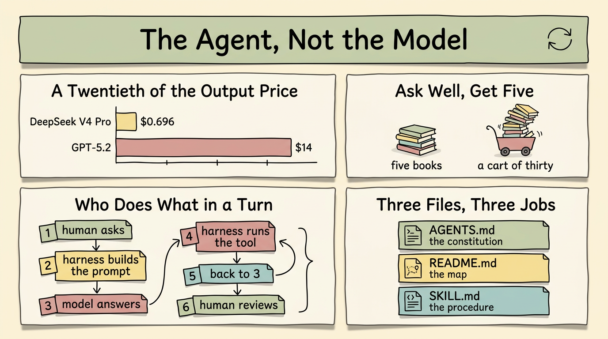

*2026-10-22*

**Thesis:** The model is the least interesting part of the stack. What comes out of a session is decided mostly by the loop an agent runs around the model — and that loop is only as good as the instruction it was given. The real skill is not technical. It is saying precisely what you want.

This is not a survey. It is one person's experience after about a year of heavy use, and the only measurements in it are my own.



## The bottleneck isn't the model

Hundreds, maybe thousands of models now sit in the catalogues: free ones, paid ones, confusing ones. Claude, OpenAI and Google are probably still the top three... maybe. New entrants keep arriving with a chart that says they won something.

The chart has little to do with my work. I write articles, code, review and analyze code, and keep repositories organized. None of it is very complex; all of it needs to be logical and precise. So: **benchmark performance is mostly marketing** — a way to attract attention and investment. That is not a claim that benchmarks measure nothing. They measure something. It just isn't the thing I'm paid for.

The practical version: **a cheaper model does not much degrade the output**, for work like mine. DeepSeek V4 Pro costs \$0.348 / \$0.696 per million input / output tokens; GPT-5.2 costs \$1.75 / \$14. A twentieth of the output price, for a model that is still frontier-capable. The numbers and the method are in [my model-selection notes](https://github.com/j3ffyang/ai-thoughts/blob/main/docs/260927-opencode-openrouter-model-selection.md).

That is not a claim that every model is equally good. It is that **the gap between models is smaller than the gap in their price**, and that my work rarely lands in the narrow zone where the top model decides the outcome. If yours does, this article is not for you, and that's fine.

### The other half: the human

The human half is easier to see in a librarian than in a benchmark table.

Ask a good librarian for a reading list and you get one. Say what you already know, why you want it, how much time you have — and you get five books you will actually finish. Say "something about history" and you get a cart of thirty. Every one of them is good. You will read none.

The librarian is not the problem, and the shelf is not the problem — nobody said how much you can carry, and no librarian can read a book on your behalf.

A bigger context window is a bigger cart. Whether it grows to 10M tokens does not help me: I still cannot hold it, check it, or decide from it. I become the bottleneck exactly where the machine's output meets my attention. There is one honest exception: when the output goes to another machine — a script, a summarizer, a next model — the cart is fine, because nobody has to read it. That is a different story from this one.

So the work does not fail at the model's edge. It fails at the reader.

## What the agent actually does

The agent is the part that got smart. Not the model — the harness that runs the loop, plus the instructions you hand it.

A turn looks roughly like this:

```
┌──────────────────────────────────────────────┐
│ 1  human asks                                │
│ 2  harness builds the prompt                 │
│    system + AGENTS.md + history + tools      │
│ 3  model answers: text, or a tool call       │
│ 4  harness runs the tool, appends the result │
│ 5  back to 3, until the model stops asking   │
│ 6  human reviews, and decides the next step  │
└──────────────────────────────────────────────┘
```

Every turn rebuilds that prompt from scratch: the harness keeps no state the model can see, only what it re-sends.

The tool call is worth being precise about, because it is the heart of the argument: **an agent does not search the web because the model "doesn't know".** The model does not introspect its own knowledge and dispatch a sub-agent when it finds a gap. It emits a tool call; the harness honours it; the result becomes new context. Searching, editing files, running the tests, spawning a sub-process — all of that is the harness side of the loop, not the model's cleverness.

So the quality of what comes out is decided by:

- how the agent digested and, sometimes, rewrote your question
- which tools it had, and whether it reached for them at the right moment
- how it read what came back from a search or a file
- how it organized what it collected, and whether it addressed what you actually asked
- whether it followed up the unfinished parts, or quietly declared victory

None of those are settings on the model. They are behaviour, and behaviour is written down somewhere — in instructions.

## The only interface you have is the instruction

Working well with an agent comes down to one skill: making the thing in your head legible to the thing on the other side. **Precisely. Accurately. Clearly.** As few gaps as possible for it to fill in on its own.

It is a conversation with no partner present: you say what you want once, in writing, and a later session re-sends only what the files hold.

In practice you do it in three files:

| File | What it is | What belongs in it |
|---|---|---|
| `AGENTS.md` | the constitution | rules that hold for every session: approval gates, what is never handed over, the review requirement |
| `README.md` | the map | what the project is, how it is laid out, what it does not do |
| `SKILL.md` | the procedure | one task, step by step, with the checks that prove it worked |

Three different jobs: what must always be true, where things live, and how one job gets done. When they overlap or contradict each other, the agent picks a reading and acts on it — and you find out later which reading it picked. (Whether they should be written like a maintenance manual is [a separate question](https://github.com/j3ffyang/ai-thoughts/blob/main/docs/261019-ste100-agent-instructions.md).)

I don't have to look far for the evidence. The repository this article lives in is the argument: `AGENTS.md` at three levels, `.opencode/skills/` for the procedures, a README generated from a YAML manifest, and scripts the agent runs to keep the output honest. When the instruction was vague, the output was vague. When I wrote the constraint down — never commit unasked, no hard-wrap, the box must be square — the behaviour changed, and it stayed changed.

## A loop, not an arrow

So the workflow is not a line. It is a loop:

```
instruction ──▶ agent loop ──▶ artifact
      ▲                            │
      └──────── you review ────────┘
```

The instruction feeds the agent, the agent produces an artifact, and then **you** look at it and decide. The review step is the whole reason the top model doesn't decide your outcome: the artifact comes back to a human either way, and the judgment at that point is yours.

The review is also where the next instruction comes from. Every rule in my `AGENTS.md` started as me noticing something in an artifact I did not want to see again.

## Closing

Every item here is about the quality of communication between a human and a machine — a strange thing to be the skill, and yet here we are. The prompt is the program, and the agent is the interpreter. For the practices that go with this argument — what to understand, what to never hand over alone, how to keep the agent in the loop — see [the earlier article](https://github.com/j3ffyang/ai-thoughts/blob/main/docs/260922-what-to-know-work-with-ai.md). That one is the how. This one is the why.

The rules I actually require of my own team are [one page of rules](https://github.com/j3ffyang/ai-thoughts/blob/main/docs/261104-what-i-tell-my-team-about-ai.md).

The models will keep changing. The loop won't.

btw, i use arch
