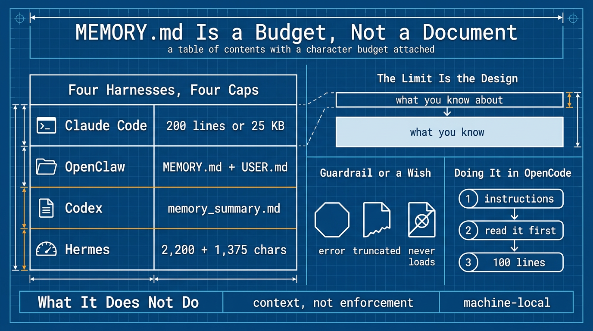

*OpenCode v2.2.5, November 2026.*

Everyone who wants an agent with memory builds the same thing first: one long file where the agent writes down everything it learns, loaded at the start of every session. It feels obvious, and no harness shipped it that way.



## Background

I did not come to this by reading documentation. I came to it by copying a file.

In both Hermes and OpenClaw, I created `MEMORY.md` by hand. I wrote the entries myself, edited them when they went stale, and pruned them when the file got long, because that is what the docs described: a file in the agent's workspace that it reads at the start of a session.

Then I went looking for the equivalent in OpenCode and found nothing — no memory file, and nothing about memory in the docs. I put a `MEMORY.md` where I expected it to go and the agent never saw it. That was the first hint that "memory file" is not a feature of the category, but a convention inside some products.

Claude Code confused me in the other direction. It already had a memory file I never wrote, one it maintains itself, and it was not the document I expected. It was a list of one-line pointers into a directory of topic files. I had been treating memory as a place to write things down. This was a table of contents.

So I read what the four of them actually do, and wrote it down, because I could not find it stated in one place.

All four end up with a file literally named `MEMORY.md` — Claude Code, OpenClaw, Codex, and Hermes. None is a document. Each is a small layer loaded at session start, with the bulk kept elsewhere and fetched only when needed.

| Where | What loads at session start | What waits |
|---|---|---|
| Claude Code | first 200 lines or 25 KB of `MEMORY.md` | topic files, read on demand |
| OpenClaw | `MEMORY.md` + `USER.md` (optional) | `memory/YYYY-MM-DD.md`, indexed and searchable (today's and yesterday's load at session start) |
| Codex | `memory_summary.md`, once the `memories` feature is enabled | `MEMORY.md` and the rest of the generated store, searched on demand |
| Hermes | `MEMORY.md` + `USER.md`, frozen snapshot (2,200 + 1,375 chars) | past sessions, via `session_search` |

Claude Code's file is a real index — the index of its auto-memory directory, not its instruction file, which is `CLAUDE.md`. One line per memory, usually ending in a pointer to a topic file. OpenClaw's is a summary you read — durable facts and decisions stated outright. Codex takes the same idea furthest: it injects only `memory_summary.md`, a compact overview, and the agent searches `MEMORY.md` and the supporting files when a task looks related. Different flavours, same constraint. Keep it small or it stops being read.

The literal reading of that table is a ceiling. Three of them cap the memory file itself; Codex caps the summary instead. Either way it is prompt space being measured — lines, kilobytes, characters, tokens — not the file. So `MEMORY.md` is not a place where memory lives — it is a budget of prompt space that happens to be backed by a file on disk.

Which leaves the definition worth carrying: `MEMORY.md` is not a log, not a journal, and not a database. It is a table of contents with a character budget attached — the only two things a session-start injection can be.

## The limit is the design

Claude Code's cap has a sharp edge: the write succeeds. The file stays on disk intact, and the error it returns tells the agent to rewrite the index, because everything past the cap is dropped on the next load.

That is not a limitation to work around. It forces the only split that matters: the small file says what you know about, and the detail files hold what you know. A single document cannot make that split, so it grows until it is 400 lines, gets injected in full every turn, and gets skimmed the way you skim a 400-line file.

OpenClaw states the same rule as advice rather than an error: if `MEMORY.md` outgrows its budget, the injected copy is truncated, and that is your signal to move detail into `memory/*.md`.

Hermes budgets the same idea in characters: 2,200 for `MEMORY.md` and 1,375 for `USER.md`, roughly 800 and 500 tokens, with room for 8–15 entries in the memory file and 5–10 in the profile. Both go in as a *frozen snapshot* taken once at session start, so a mid-session save reaches the disk immediately but not the prompt until the next session.

When a write would overflow, its `memory` tool returns an error and tells the agent to free the stated number of characters — consolidate or delete first, then retry — so nothing is dropped silently. What doesn't fit needn't be lost either: every session is kept in SQLite and can be full-text-searched on demand, which is the working layer to `MEMORY.md`'s curated one.

That is the difference between a guardrail and a wish. Claude Code and Hermes answer an overrun with an error; OpenClaw truncates and shows you the damage in `/context`; Codex never loads `MEMORY.md` at all, only the summary. Where the harness will not stop you, the budget is yours to police, and nothing will tell you the file quietly stopped being read.

## Why it exists at all

Because the context window will be taken from you. The Anthropic memory tool appends this to the system prompt automatically:

> ASSUME INTERRUPTION: Your context window might be reset at any moment, so you risk losing any progress that is not recorded in your memory directory.

That is the whole justification. Not "it would be nice to remember" — the window is going to close, and nothing you did not write down survives it.

## Doing it in OpenCode

OpenCode has no memory file. It auto-discovers `AGENTS.md`, falling back to Claude Code's `CLAUDE.md`, and nothing memory-shaped. So you assemble the slot yourself.

First the rules, in `AGENTS.md`. Second the small file, injected with one config line in the project's `opencode.json`:

```jsonc
{
  "$schema": "https://opencode.ai/config.json",
  "instructions": ["MEMORY.md"]
}
```

In the global `~/.config/opencode/opencode.jsonc`, use an absolute path instead: the docs do not say what a relative one resolves against.

Third the detail, in ordinary files read only when something points at them — which is exactly how OpenCode already loads skills. A one-line description of every skill sits in context; the body loads only when the description matches. Same machine, applied to procedures instead of facts. Hermes' docs reach that conclusion from the other direction, recommending a skill over a memory entry for anything that would compete for the 2,200-character budget.

The filename is arbitrary. `MEMORY.md`, `memory.md`, `notes.md` — OpenCode does not care, and it will load none of them without that config line. That is where a Claude Code migration quietly breaks: `MEMORY.md` comes along and does nothing.

Keep the file an index:

```md
# Project memory — index only

One line per entry: `- (YYYY-MM-DD) <fact>. See detail/<file>.md`
Delete entries older than six months, or contradicted by the code. Do not archive.

## project
- (2026-11-01) Deploys go to eu-west-1; forced by a 2025-11 data-residency contract. See detail/deploy.md
- (2026-10-14) `make test` needs Docker running. Without it the suite exits 0 and tests nothing.

## feedback
- (2026-10-20) Do not reformat YAML I did not ask you to touch. It happened twice.
```

The number is yours to pick. 100 lines is plenty, and well under Claude Code's 200 — count it with `wc -l`. Passing it is the signal to move detail into a file.

If you build only one half, build the read. The usual failure is a rule saying "append your findings to `MEMORY.md`" with nothing saying "read it first", which produces a journal nobody opens.

And the rule that makes it work, also in `AGENTS.md`, because nothing will enforce it:

```md
Before answering a question about project state, deployment, or a past decision,
read `MEMORY.md` and open the detail file it points to before stating a fact.
Never answer from an index line alone.
```

I built a throwaway one to test this on v2.2.5. The file loads. Asked why a project used eu-west-1 — a question the index cannot answer — the model read the detail file and quoted it. It also re-read `MEMORY.md` itself, already in context, which is a small tax worth knowing about.

## Whether to build it

The case for it is already made: sessions end. The case against is smaller and more practical.

An `instructions` file is injected in full, every session. A 100-line index is roughly a thousand tokens before you have asked anything — cheap, but it loads every time and buys nothing on a day when the answer is already in the code.

The bigger cost is maintenance. A memory file is a second surface to prune, and it goes stale at a different rate from your rules. Put a fact that changes weekly into `AGENTS.md` and you are editing the constitution every week.

So the test is not whether it is good practice. It is whether you are losing facts. Build it when a new session keeps re-deriving something you have already settled. Until then it is a capability you are not using, not a defect in your setup — which is where I left mine: `AGENTS.md` for the rules, skills for the on-demand half, no facts index, and nothing lost.

### Where it lives is part of the decision

If you build one, choose its home before the first entry. A memory file collects what the code cannot tell you: project names, deploy regions, file paths, decisions, sometimes a customer's constraint. That is the content you would not paste into a public issue.

My config is symlinked into a repo that publishes, so a `MEMORY.md` beside it would have gone out with the next push. Tracking and publishing cannot be separated in a public repo. If you want git history and privacy both, the file needs a private repository, or no repository at all — and that repository is also the only thing that carries it to a new machine.

And the failure is silent, which is the whole problem: it sits on disk looking authoritative while every session ignores it — the same no-op this article opened with.

## What it does not do

Date every entry. An agent-recorded fact has no auditor; six weeks later it is wrong with the same confidence it was right, and it outranks the code because someone wrote it down. Claude Code at least stamps the write time itself, as a `modified` field in the memory file's frontmatter, so the age of a fact is visible to whoever reads it back.

A lot of what people file under memory is a rule they have not decided yet, or an environment fact that belongs in a config file. A deploy region is memory. "Use tabs, not spaces" is a rule for `AGENTS.md`. Whether Docker is installed is a question for `docker --version` — if the machine can answer it, it does not belong in memory.

Memory is context, not enforcement. Claude Code says so outright, and points at a hook, not a memory entry, when you need to block an action. A memory entry can tell the agent what you decided. It cannot stop the agent doing otherwise.

Which leaves the honest limit. Memory does not buy you volume: a session that fits everything still ends, and the next one starts empty. Nor does it travel on its own: auto memory is machine-local, so a new laptop starts empty until you carry the file there. What memory buys is a table of contents that survives the reset.

## Sources

- Claude Code, [How Claude remembers your project](https://code.claude.com/docs/en/memory)
- OpenClaw, [Memory overview](https://docs.openclaw.ai/concepts/memory)
- Codex, [Memories](https://developers.openai.com/codex/memories)
- Anthropic, [Memory tool](https://platform.claude.com/docs/en/agents-and-tools/tool-use/memory-tool)
- Hermes, [Persistent Memory](https://hermes-agent.nousresearch.com/docs/user-guide/features/memory)

btw, i use arch
