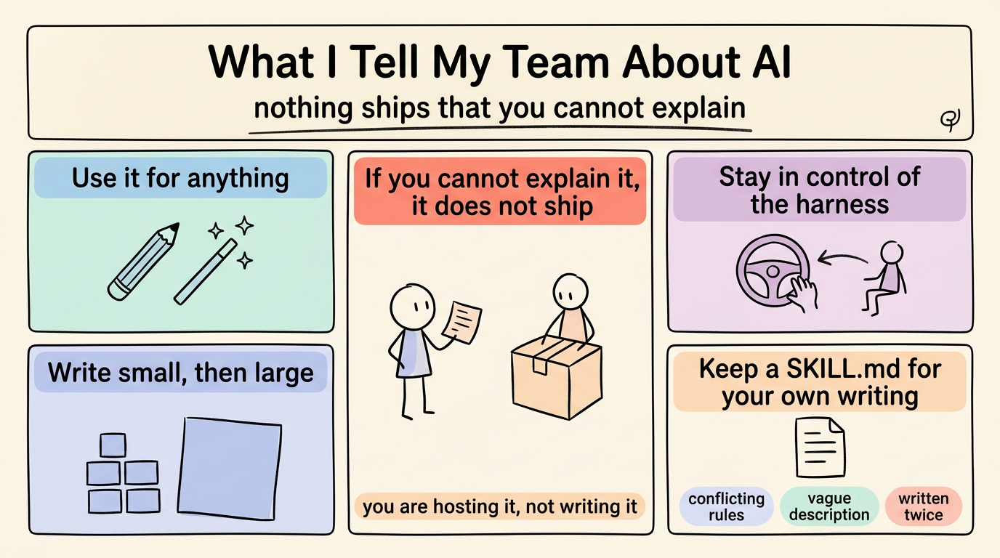

*2026-11-04*

**Thesis:** The licence is not the problem. Explainability is. Use AI for anything you like — but nothing ships that you cannot explain.

## Use it for anything

I don't police tool use. Code, articles, how-tos, instructions — use it. The question is never "did AI write this". It is "can you explain what it did, and why it is the way it is".

## If you cannot explain it, it does not ship

This is the rule I actually enforce. If you cannot explain what it wrote, the work is stranded: you cannot maintain it, and nobody else can review it. It does not ship. A review catches a sample. Explanation is the only test that covers the whole thing.

I don't mean reciting it line by line. I mean: what does this do, why this way and not another, what happens when it fails. If the answer is "the model wrote it", the work has not started yet.

A concrete version: the retry runs three times, backs off between attempts, and gives up after twenty seconds. Why three? Why twenty? What happens when all three fail? If those are answers you can give, you own the code. If they are answers you would have to go and look up in a file you have not read, you are hosting it, not writing it.

## Stay in control of the harness

The harness is the program that runs the loop around the model. You are the one who decides what goes in, what comes back, and what ships. That position is only real if you can explain the output. Otherwise the harness is driving and you are approving.

## Write small, then large

Start with a paragraph, a function, a section, and let it see your pattern in small pieces before you hand it a thousand lines. Small pieces are explainable. A large one arrives already past the point where you can check it.

## Keep a `SKILL.md` for your own writing

Rules you repeat are rules worth writing down: how you structure an argument, what you never do, which checks prove it worked. Put them in a `SKILL.md` — that is what a skill is: a procedure written down. The rules I would put in mine: open with the claim, never hard-wrap, one idea per paragraph, and check the box diagrams are square. Then revise it as your experience grows.

That last part is the step people skip. Read it back in a month and look for three failures: two rules that conflict, a description too vague to act on, and the same instruction written twice. All three make the agent pick a reading, and you find out later which one it picked.

## Closing

None of this is about distrusting the tool. It is about staying the one who understands the work. The agent can write faster than you can read, and that is exactly why the reading is the job.

Why the loop matters more than the model is [a separate argument](https://github.com/j3ffyang/ai-thoughts/blob/main/docs/261022-agent-not-model.md). This page is only what I ask of people.

btw, i use arch
