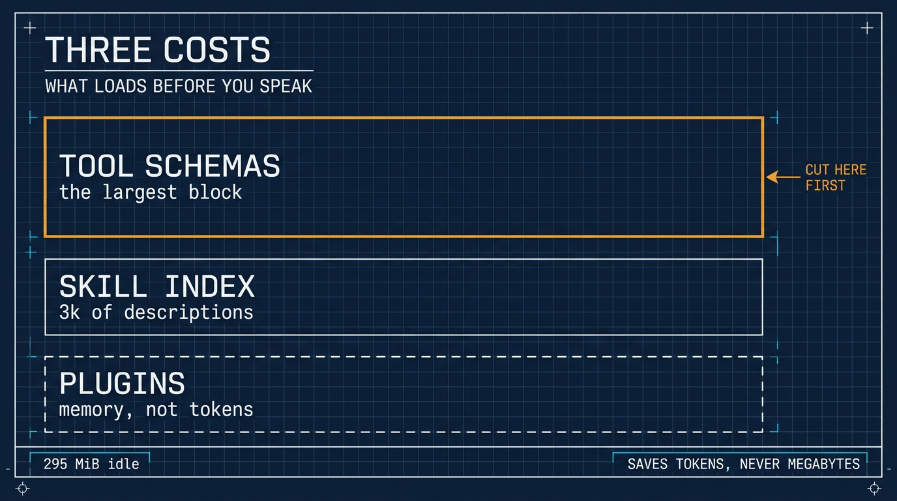

# Disable the Skills You Will Never Use in Hermes ⚕

*2026-11-05*

**Thesis:** A fresh Hermes install seeds a catalog of skills nobody asked for, and their descriptions load before you say a word. Switch off the categories you will never touch, and load the rest on demand.

## A 4 GB VPS, a 2-core CPU, and a catalog

I installed Hermes again on a small VPS: 4 GB of RAM, 2 cores, no GPU, running Debian. The install itself was unremarkable. What I noticed came later, in the skill list.

A small box is the right place to notice this, because it rules out the usual excuse. If anything were going to be tight, 4 GB would show it first — and nothing did. The problem was not the machine.

For the record, `top` on that box after a couple of hours — the unrelated `sshd` row trimmed:

```
top - 09:15:22 up  2:33,  1 user,  load average: 0.08, 0.02, 0.01
Tasks: 116 total,   2 running, 114 sleeping,   0 stopped,   0 zombie
%Cpu(s):  0.5 us,  0.0 sy,  0.0 ni, 99.2 id,  0.0 wa,  0.0 hi,  0.3 si,  0.0 st
MiB Mem :   3817.6 total,   1085.3 free,    601.0 used,   2320.4 buff/cache
MiB Swap:      0.0 total,      0.0 free,      0.0 used.   3216.5 avail Mem

    PID USER      PR  NI    VIRT    RES    SHR S  %CPU  %MEM     TIME+
   3197 jeff      20   0  756044 302472  41080 S   0.7   7.7   1:20.99 hermes
```

Read it plainly: this is hermes **idle** — 0.7% CPU, no task running — and it already holds 295 MiB resident (302,472 KiB), 7.7% of 3.8 GB, with 3.2 GB available and no swap in use. Load average 0.08 across two cores, so nothing here is straining. The numbers to remember are the idle baseline: 295 MiB of RAM held, not freed — 255 MiB of that private once the 40 MiB of shared pages are discounted — and a 3k-token catalog index before I touched it. Both are paid before you ask the first question.

## What the index costs

Hermes loads skills by progressive disclosure: nothing arrives whole. The first level is an index — name, description and category for every skill — and the full text loads only when the agent asks for that skill. Hermes' own docs put the full-catalog index at roughly 3k tokens.

Three thousand tokens is not a crisis. It is also not free, and it is spent before I have asked anything, on descriptions of skills I will never call. An index is context: it competes with the instructions I actually wrote, and it nudges the agent toward whatever looks adjacent to the task at hand.

On a 4 GB box this never shows up as RAM pressure. It shows up as an agent that has already been told about most of a catalog it does not need.

**Disabling a skill saves tokens, never megabytes.**

## What I disabled

The install seeds a full catalog. I opened the config, chose **Toggle by category**, and switched four off:

```
hermes skills config
# then: Toggle by category → emails, productivity, social-media, software-development
```

That list is mine, not a recommendation. I do not run an email workflow from an agent session, I do not build social-media pipelines, and the software development I do belongs to OpenCode, where the project's own `AGENTS.md` and skills already describe it. Productivity is the vaguest of the four, and vague is the last thing I want an agent guessing at.

Leave whatever you use weekly. The point is not a minimal install for its own sake; it is that a skill you have never opened is noise wearing a tool's clothing.

Disabled is the right verb, by the way. The files stay where they are, and one toggle brings the category back — nothing is deleted, so nothing has to be reinstalled later.

## Why disable instead of ignore

Because ignoring does not work. The index is read every session, so a category you never touch still votes on what the agent considers available on that platform, and it is still paid for at the start of every conversation there.

My preference is the other default: load them when I need them. If I want the email skill next month, one toggle brings the category back — cheaper than carrying it through a hundred sessions in case, and cheaper than reinstalling it after a purge.

## If your build differs

The category toggles are what my install offers, and they only disable. The documented commands cover the other two shapes of the same idea:

```
hermes skills opt-out            # stop future seeding, touch nothing on disk
hermes skills opt-in --sync      # undo, and re-seed now
hermes skills opt-out --remove   # the destructive one: delete unmodified bundled skills
hermes profile create research --no-skills   # start a profile with no catalog
```

The [skills documentation](https://hermes-agent.nousresearch.com/docs/user-guide/features/skills) is where I would start if a command has moved.

None of this touches the toolkit itself. Disabling a catalog entry hides one skill; removing the `skills` toolset from a platform hides `skills_list`, `skill_view` and `skill_manage` together; and the write gate is a third thing again — tools kept, installs staged. If you want the bot to stop offering skills at all, that is a toolset decision, not a catalog one. [The hardening guide](https://github.com/j3ffyang/ai-thoughts/blob/main/docs/261108-hermes-guest-hardening.md) covers the other two.

## The index is the smallest of three costs

Weight in an install comes in three kinds, and only two of them are paid in tokens:

| Cost | Paid | Reduced by |
|---|---|---|
| Skill index | every session, in tokens | disabling skills, as above |
| Tool schemas | every session, in tokens — usually the largest block | removing toolsets |
| Plugins | startup and memory, not context | disabling plugins |



Tool schemas are the quiet one. Every enabled toolset ships a JSON schema before you speak, and a full `hermes-cli` platform carries dozens of them; turn off the six you never call and the prompt shrinks by more than the skill index ever cost. Plugins are a different currency — a platform plugin for Telegram costs process memory and startup time, not prompt space, and on this 4 GB box the idle figure in the first section is already comfortable.

```
hermes tools                     # per platform; interactive, needs a real terminal
hermes plugins list              # what is installed, and what is switched on
hermes plugins disable <name>    # switch one off without removing it
```

`/context all` inside a session prints the per-skill and per-toolset breakdown, which is the only way to see whether a removal actually helped. Guesswork here runs in the wrong direction: the plugin list looks like the fattest thing and is usually the cheapest.

## Closing

A small VPS is a good place to notice this, because it removes the usual excuse: it is not the hardware, and it never was. The agent reads the skill index before you speak. Everything in it should earn its place there.

btw, i use arch
