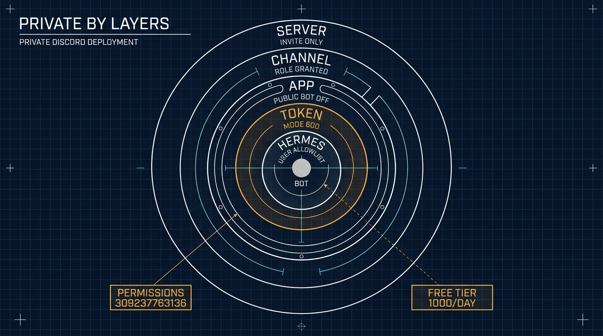

# Running a Private ⚕ Hermes Agent on a VPS, Wired to Discord

*2026-11-07*

**Goal:** private everything. A private server, a private channel, a private app that only you can install. Nobody reaches the bot without an invite you issued and an allowlist entry you made.

**Status:** working — a friend joined the server and held a working conversation with the bot. The bot answers `@mentions` inline in its channel, and DMs for anyone on the allowlist. This article documents that private variant: owner-only app install, private channel, allowlist.

Upstream reference: <https://github.com/NousResearch/hermes-agent/blob/main/website/docs/user-guide/messaging/discord.md>

## Why not Google Chat

Discord was the second attempt. The first was Google Chat, and it swallowed two or three days.

Hermes ships a Google Chat adapter, so the work looked ordinary: a Google Cloud project, the Chat API enabled, a service account, an endpoint. The wall sits underneath. A Chat app needs a Business or Enterprise Google Workspace account — Google's own quickstart lists that as a prerequisite. A free Gmail account cannot enable the Google Chat API at all, and nothing in the flow says so. The API just stays disabled, in a project you own, with no switch that turns it on.

The Google Cloud console then added insult. The Chat API dashboard looks like a Microsoft Windows product: panels from different design generations, boxed-in controls everywhere, dead space where a control should be, and no sign that anyone ever looked at the whole screen at once. It is one of the ugliest interfaces I have used, and if a Microsoft team built it, that would explain everything.

I gave up on Google Chat. Discord took a fraction of the time, and what follows is the setup that worked.

**The leftover.** Giving up does not remove the adapter. It stays configured and reports a dead Pub/Sub subscription on every health check, so turn it off:

```bash
hermes config set platforms.google_chat.enabled false
hermes gateway restart
```

Delete the `GOOGLE_CHAT_*` lines from `~/.hermes/.env` while you are there. If the warning survives the restart, it is not a live failure: `gateway status` prints the last saved snapshot from `~/.hermes/gateway_state.json`. Stop the gateway, move that file aside, start it again.

## What the pieces are

| Piece | What it is | Where it lives |
|---|---|---|
| Hermes Agent | the agent runtime + gateway process | VPS, under one normal user account |
| Discord application | the bot's identity (name, avatar, token, intents) | Discord Developer Portal |
| Discord server | a private server you own | Discord |
| The bot in the server | the application installed into that server with a permission set | Discord |
| Allowed users | the Discord user IDs Hermes will actually answer | `~/.hermes/.env` on the VPS |
| Model | the LLM behind the bot — here a free OpenRouter variant | `~/.hermes/config.yaml` |

The bot token is the only Discord secret. It lives on the VPS and never in the server, the repo, or a chat message. The OpenRouter key is the other one, and it lives in the same place.

## Part 1 — Hermes on the VPS

Run everything as a **normal user**, not root. The installer writes to `~/.hermes/` and `~/.local/bin/`.

```bash
# prerequisites + install
curl -fsSL https://hermes-agent.nousresearch.com/install.sh | bash
source ~/.bashrc
hermes doctor
```

### The model: Nemotron 3 Ultra, free

Nothing on Discord works until the agent itself can answer. This install runs an OpenRouter free variant, so the only cost of a conversation is the daily request cap.

| Field | Value |
|---|---|
| Provider | `openrouter`, `https://openrouter.ai/api/v1` |
| Model | `nvidia/nemotron-3-ultra-550b-a55b:free` — Nemotron 3 Ultra, 550B total / 55B active, 1M context, tool calling |
| Price | \$0 in, \$0 out (free variant) |
| Ceiling | 1000 requests per UTC day, reset at 00:00 UTC — accounts that have never bought credits get 50 |

```bash
hermes config set OPENROUTER_API_KEY sk-or-v1-...
hermes config set model.provider openrouter
hermes config set model "nvidia/nemotron-3-ultra-550b-a55b:free"
hermes config show
```

Check what is left in the day's budget. `hermes config set` writes the key to `~/.hermes/.env`, and your shell does not read that file, so load it first:

```bash
set -a; . ~/.hermes/.env; set +a
curl -s https://openrouter.ai/api/v1/key \
  -H "Authorization: Bearer $OPENROUTER_API_KEY" \
  | jq '.data.free_model_daily_requests'
# {"used": 12, "limit": 1000, "remaining": 988}
```

The cap is one counter across every `:free` model on the account, so switching to another free model does not restore service. When it is gone, replies stop until the reset.

Two things worth separating when the bot looks broken: a 429 is a rate limit (the daily cap, or the 20-requests-per-minute free-tier burst), and a slow or refused reply is free-tier priority at peak hours. Neither is a Discord problem.

Put the gateway under systemd so it survives logout and reboot:

```bash
hermes gateway install     # user unit: hermes-gateway
hermes gateway start
hermes gateway status

sudo loginctl enable-linger $USER   # keep it running after SSH disconnects
```

Follow the log with `journalctl --user -u hermes-gateway -f`.

On a headless VPS you can use a boot-time system unit instead: `sudo hermes gateway install --system`, then `--system` on `start`/`status` and `journalctl -u hermes-gateway -f` without `--user`. It also makes every restart need root, including the one at the end of `hermes update` — the user unit plus linger avoids that.

**Do not** add a `ExecStopPost=/bin/kill -9` drop-in. The installed unit already stops cleanly and sets `Restart=always`; a hard-kill drop-in turns every restart into a respawn loop.

From here on, every config or `.env` change takes effect with `hermes gateway restart`.

## Part 2 — The Discord application

At <https://discord.com/developers/applications> → **New Application**.

**Bot page:**

- **Public Bot → OFF.** This install is private: with Public Bot off, **only you can add the app to a guild**. Nobody else can authorize it, whatever URL they hold. Set the install link to **None** below first — Discord rejects a private app that keeps a default install link.
- **Require OAuth2 Code Grant → OFF.**
- **Privileged Gateway Intents:** enable **Server Members Intent** and **Message Content Intent**. Message Content is the hard one: with it off Discord refuses the connection and the bot never comes online — the number-one failure. Server Members is what lets Hermes resolve usernames and roles. Save changes.
- **Token → Reset Token**, copy it once. It is never shown again; a lost token means resetting it.

If the app was created earlier with Public Bot on, it is still installable by anyone holding the URL — see **Hardening after the fact** at the end of this part.

**Installation page** (invite link):

- **Installation Contexts:** Guild Install.
- **Install Link → None.** No "Add App" button, no App Directory listing, no URL to leak. A manual authorize URL still works for you, the owner.
- **Scopes:** `bot` + `applications.commands`.
- **Permissions:** `309237763136` (recommended) — View Channels, Send Messages, Embed Links, Attach Files, Read Message History, Create Public Threads, Send Messages in Threads, Add Reactions. `117760` is the minimum; `309240908864` adds voice.

Manual URL — keep it to yourself:

```
https://discord.com/oauth2/authorize?client_id=YOUR_APP_ID&scope=bot+applications.commands&permissions=309237763136
```

**Install into your server:** open that URL **yourself**, pick the private server, Continue → Authorize. The app is in the server from that moment — **Server Settings → Integrations** lists it. A channel's member list is a different thing: it only shows members who can view that channel, so the bot appears there after the grant in Part 4, and online after the gateway starts. This is the only time the app is installed; friends never do it. Permissions granted at install time do not grow later — re-open the URL to grant more.

**Hardening after the fact.** An app created with the defaults is public: Public Bot on, a Discord-provided install link, and anyone holding the URL can add it to their own server. Making it private has an order, because Discord refuses the second step while the first is undone:

1. **Installation** → **Install Link** → **None**, Save Changes.
2. **Bot** → **Public Bot** → OFF, Save Changes.

Leave it half-done and the app stays installable — the error Discord gives is *Private application cannot have a default authorization link*. Neither switch removes the app from a server where it is already installed; they only block new authorisations. After that, install with the manual URL above. If Discord answers *Verified apps must be public*, the app carries a Verified badge, and verification exists only for bots in 100 or more servers — it should not apply here.

## Part 3 — Wire Hermes to the bot

Fast path, which verifies the token, checks the intents, prints an authorize URL, and allowlists you:

```bash
hermes gateway setup     # choose Discord, paste the token
```

Manual path — `~/.hermes/.env`:

```bash
DISCORD_BOT_TOKEN=your-bot-token
DISCORD_ALLOWED_USERS=284102345871466496
```

`DISCORD_ALLOWED_USERS` is a comma-separated list of **user IDs** (Discord Settings → Advanced → Developer Mode → right-click a user → Copy User ID). Without it — or `DISCORD_ALLOWED_ROLES`, or `DISCORD_ALLOWED_CHANNELS` scoping the bot to specific channels — the gateway denies everyone.

Then:

```bash
hermes gateway restart
```

## Part 4 — Giving the bot its own channel

Discord offers no CLI for channel creation, so this part is one GUI errand, one permission grant, and one config key.

**Create it.** Right-click the category — or the server name, for a top-level channel — then **Create Channel** → **Text**, named for the bot, e.g. `hermes`.

**Private or not.** This build makes the channel private: `@everyone` — the default role every member of the server holds — gets nothing, and visibility is granted per role. Server Settings → Roles → `@everyone`: turn View Channels off, and turn off the guild-level permissions too. **Create Invite** matters most: a member who can invite can bring in someone you never approved, whatever your allowlist says. Keep Manage Server, Manage Roles, and Manage Channels for yourself. A public channel would work, but then every member sees the bot's conversations, which defeats the point of a private server.

**Let the bot into a private channel.** **Edit Channel → Permissions → Add members or roles**, pick the app's role (named after the application, e.g. `Hermes`, and listed among roles once the app is installed), and grant:

| Permission | Why |
|---|---|
| View Channel | without it the bot never receives the message, and it is missing from that channel's member list. The channel is silent, not broken, and `gateway.log` shows nothing |
| Send Messages | replies |
| Read Message History | context, and the history backfill on each mention |
| Embed Links, Attach Files | rich answers and file output |
| Create Public Threads, Send Messages in Threads | only if you want auto-threading |

An install-time permission only sets the ceiling; on a private channel this override is what lets the bot in. Friends need View Channel on the same channel from a member role, independently of the bot.

**Pick how the channel behaves.** Copy the channel ID first (Developer Mode → right-click the channel → **Copy Channel ID**), then choose one of three modes:

| Mode | Config | Behaviour |
|---|---|---|
| Mention, inline — what this install runs | `no_thread_channels` | answers `@mentions` in the channel itself, no thread |
| Mention-free | `free_response_channels` | answers every message, inline |
| Thread per conversation (default) | neither | answers `@mentions` in a new thread |

```yaml
# ~/.hermes/config.yaml — the mode this install runs
discord:
  no_thread_channels:
    - 123456789012345678   # <channel id> — reply inline instead of opening a thread
```

A mention-free channel already replies inline, so it needs no `no_thread_channels`. To force one thread per top-level message in one, add `free_response_auto_thread: true` (it needs `discord.auto_thread`, which is on by default).

```bash
hermes gateway restart
hermes gateway status
```

The same knobs exist as `DISCORD_NO_THREAD_CHANNELS` and `DISCORD_FREE_RESPONSE_CHANNELS` in `.env`; env wins when both are set.

**From the API** — the REST call needs **Manage Channels**, which `permissions=309237763136` does not include, so the bot gets a 403. Create the channel from your own client, or re-invite the app with Manage Channels (`309237763136` + `16`) first.

## Part 5 — Letting friends in

The app stays yours. A friend never opens the Developer Portal, never installs anything, and never receives a bot URL. Four independent gates decide whether they can talk to it, and every one has to be open. The channel scope is the only one that starts open.

| Gate | Where it is set | What it controls |
|---|---|---|
| Server invite | Discord | whether they can see the server at all |
| Channel visibility | channel permissions | whether they can see `#hermes` |
| Hermes channel scope | `~/.hermes/.env` | which channels the bot answers in |
| Hermes allowlist | `~/.hermes/.env` | whether the bot answers them |

An allowlisted friend reaches the agent's tool surface on this VPS, not just a chat window — treat the allowlist like a shell account, and see *Keeping it private* below for what that means.

**Commands are a second surface.** With no admin split configured, every allowlisted user also gets the full slash-command set — including `/learn`, which writes a skill into `~/.hermes/skills`, plus `/save`, `/rollback`, and `/update`. Tools and commands are gated separately: `platform_toolsets` never sees a slash command. Set `allow_admin_from` and `group_allow_admin_from` to your ID, and give guests a short `user_allowed_commands`. The exact block — and why it belongs in `platforms.discord` rather than `gateway.platforms.discord` — is in [the hardening guide](261108-hermes-guest-hardening.md).

Before the first invite, leave **Community** off — no discovery, no vanity link. Access comes from the roles you grant.

1. Create an invite: right-click the server name → **Invite People** → **Edit invite link** → set an expiry and a max number of uses. Send that, and revoke it once they have joined. Server Settings → Invites lists and kills outstanding links.
2. They accept and land in the server. They see only the channels their role allows — `#hermes` if you granted it.
3. Collect their **user ID** (Developer Mode → right-click their name → Copy User ID) and append it:

```bash
# ~/.hermes/.env
DISCORD_ALLOWED_USERS=284102345871466496,198765432109876543
```

```bash
hermes gateway restart
hermes gateway status
```

4. They post in `#hermes`. The first reply means all four gates are open; a silence means one is still shut, and the troubleshooting table names which.

**Roles instead of a list.** Create a role such as `hermes-user`, grant it View Channel on `#hermes`, and set `DISCORD_ALLOWED_ROLES=<role-id>`. Granting or removing that one role then adds or revokes access with no config push and no restart.

**Keep the bot in one channel.** The channel-scope gate, set separately from the user allowlist:

```bash
# ~/.hermes/.env
DISCORD_ALLOWED_CHANNELS=123456789012345678
DISCORD_IGNORED_CHANNELS=987654321098765432   # optional hard deny
```

With `DISCORD_ALLOWED_CHANNELS` set, the bot answers in those channels and in DMs, and nowhere else. DMs do not honour that list — the user allowlist is their only gate.

## Keeping it private

| Layer | Setting | Effect |
|---|---|---|
| Server | no Community, no Discovery, widget off, expiring single-use invites, `@everyone` with no guild permissions — Create Invite above all | the server cannot be found or joined without a link you issued |
| Channel | private channel, explicit role perms | only granted members and the app can see `#hermes` |
| App | Public Bot OFF, Install Link None | only you can add the app anywhere; no public install surface exists |
| Token | `~/.hermes/.env`, mode 600, never in a repo or a message | the token is the real credential — it is what an attacker would want, not the app's privacy switches |
| Hermes | `DISCORD_ALLOWED_USERS` + `DISCORD_ALLOWED_CHANNELS` | an invited member with no allowlist entry gets no reply |



What this posture does **not** buy, stated plainly:

- Discord is not end-to-end encrypted. Channel messages, attachments, and DMs sit on Discord's servers, and copies sit in `~/.hermes/state.db` on the VPS.
- Every prompt leaves the VPS for the model provider (here OpenRouter's free tier) and is subject to that provider's retention.
- Allowlisting a person hands them the agent's tool surface on that VPS — terminal, files, browser — **by default**. The Discord privacy settings control *who can reach the bot*; `platform_toolsets` and `approvals` control *what it may do* once reached. [The hardening guide](261108-hermes-guest-hardening.md) is the second half of this one: it takes the write tools off Discord and leaves them in the CLI.

## How the bot behaves

| Context | Behavior |
|---|---|
| DM | answers every message, no mention needed, one session per DM. Only allowlisted users get this far |
| Server channel | answers only when `@mention`ed, unless the channel is in `discord.free_response_channels`. Replies inline when the channel is in `discord.no_thread_channels`, otherwise in a thread. With `DISCORD_ALLOWED_CHANNELS` set, only those channels |
| Thread | answers in place; a mention is not needed once it is in the thread |
| Shared channel, several people | sessions are per user by default (`group_sessions_per_user: true`) |
| Message `@mention`ing other users only | ignored (prevents jumping into side conversations) |

Useful knobs in `~/.hermes/config.yaml`: `discord.free_response_channels`, `discord.no_thread_channels`, `discord.auto_thread`, `discord.reactions`, `display.tool_progress`.

Three blocks share the name. `discord:` holds behaviour — the knobs above. `platforms.discord:` holds the connection and `extra`, which is where the admin split goes. `gateway.platforms.discord:` is another nesting the gateway still reads, shadowed by the top-level block on shared keys. Behaviour keys never belong in `extra`.

## Troubleshooting

| Symptom | Cause | Fix |
|---|---|---|
| Bot stays offline, log says privileged Gateway Intents | Message Content Intent is off | enable it, Save Changes, restart the gateway |
| Online, but silent in a channel | `require_mention` is on by default, or the bot lacks View Channel there | `@mention` it, add the channel to `free_response_channels`, or grant View Channel on a private channel |
| Online, View Channel granted, still silent | the message carried no mention — a name typed by hand stays plain text unless it is picked from the popup | retype with `@` and select the bot from the list, or send `<@BOT_ID> hello` |
| A thread opens for every message | `auto_thread` is on by default | add the channel to `no_thread_channels` |
| Online, ignores one specific person | their ID is not in `DISCORD_ALLOWED_USERS` | add it and `hermes gateway restart` |
| Friend sees the server but not `#hermes` | channel is private and their role lacks View Channel | add their role to the channel's permissions |
| Bot answers in DMs but not in `#hermes` | `DISCORD_ALLOWED_CHANNELS` is set and that channel is not in it | add the channel ID, then restart |
| Someone else cannot add the app to another server | Public Bot is off, by design — that blocks everyone else, not you | you still can: open the manual URL yourself and pick the other server |
| `Invalid token` at startup | token was reset or pasted with whitespace | reset the token, update `.env`, restart |
| Restart loop in the journal | a custom `ExecStopPost` kill drop-in | remove the drop-in, `systemctl --user daemon-reload` |
| A platform warning survives the fix and a restart | `gateway status` prints the last persisted snapshot from `gateway_state.json`, not a live probe | `hermes gateway stop`, move `~/.hermes/gateway_state.json` aside, `hermes gateway start` |
| Commands or threads fail | install permissions too narrow | re-open the invite link with `permissions=309237763136` |
| Replies stop partway through the day | free-model daily cap used up | check `free_model_daily_requests`; wait for the 00:00 UTC reset |
| Model errors, but the bot is online | `:free` variant retired or renamed | `hermes config set model <current-slug>`, then restart |

Health checks: `hermes gateway status` (online state, heartbeat, degraded reason) and `journalctl --user -u hermes-gateway -f`.

btw, i use arch
