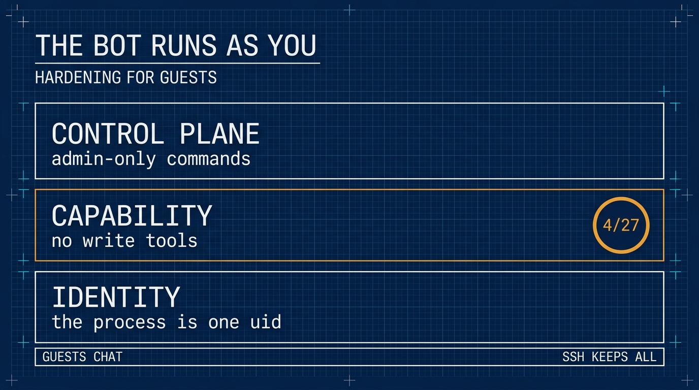

# The Bot Runs as You: Hardening a ⚕ Hermes Agent for Guests

*2026-11-08*

**Thesis:** a messaging bot is not a separate user. It is your account with a Discord adapter attached, and adding people to it adds people to your shell — so the boundary has to be drawn on the platform, not on the person.

**Goal:** members keep the bot in Discord and can add nothing that runs; you keep the full toolset over SSH.

**Status:** config-only. The Discord list below is five toolsets — four read-only, plus `skills` behind the write gate — and the CLI keeps the full set.

Related: [the private Discord setup](https://github.com/j3ffyang/ai-thoughts/blob/main/docs/261107-hermes-discord-integration.md) is the invite side, and [the skill index](https://github.com/j3ffyang/ai-thoughts/blob/main/docs/261105-hermes-skill-index.md) is what fills the library this article gates.

## A skill appeared in ~/.hermes

Yesterday a member asked the bot for a custom skill. The bot wrote one, and it landed in `/home/jeff/.hermes/skills/`. Nothing broke. That was the problem: it worked exactly as designed, and the design is "the agent may modify any skill it can see".

Skills are files. The agent creates, patches, and deletes them through `skill_manage`. If that tool is enabled on the platform the guest is talking on, a guest puts a file on your VPS by asking politely.

## Why it happened

The gateway runs as `jeff`. Every tool call — `terminal`, `write_file`, `skill_manage`, `cronjob` — inherits that uid. There is no privilege boundary inside the process, because there is no second identity to switch to.

So the invite was the mistake, not the prompt. Adding a member to the bot added them to the account that holds your SSH keys, your git config, and your home directory. [The private Discord setup](https://github.com/j3ffyang/ai-thoughts/blob/main/docs/261107-hermes-discord-integration.md) is how to issue an invite that does not hand over the account.

## The limitation worth knowing first

Hermes configures tools **per platform**, not per user. Gateway authorization is binary: a user ID is allowed or denied. There is no "this member may run a shell, that one may not" for plain chat — only slash commands split into admin and non-admin.

So everyone on one platform shares one tool list: grant yourself `terminal` on Discord and every guest has it; deny it and you lose it there too. The shell is the only place you can hold more power.

That decides the architecture. The trust boundary has to be the *platform*, or a second gateway. It cannot be the person.

## Three layers

| Layer | Question it answers | Mechanism |
|---|---|---|
| Identity | who is the process? | a dedicated unix user — needs a home outside your own |
| Capability | what can a guest make it do? | a per-platform toolset whose writes are gated |
| Control plane | can a guest undo the above? | admin-only slash commands |



Identity is the only layer that survives a tool you have not audited yet. Capability is the one that stops today's incident. The control plane keeps a guest from re-enabling what you disabled.

This article applies the second and third. The first needs a home outside your own: a tree inside `/home/jeff` cannot coexist with `chmod 700 /home/jeff`, which would lock the service user out of its own home. Everything below is the config-only path, and the tool list is the barrier.

## 1. Audit what is already there

```bash
# pick the window yourself — the day you noticed, not a date from this article
find ~/.hermes -newermt "-7 days" -type f \
  | grep -vE 'state\.db|/logs/|gateway_state\.json' | head -40
hermes skills list
hermes cron list
```

Read every new file before deleting it. A planted skill runs on every future use, so a blind `rm` is not an audit. Then check `~/.hermes/config.yaml` for keys you did not write, and `.env` for values you did not set.

## 2. Take the writes away

Every toolset that can write, and what it writes:

| Toolset | Tools | Writes to |
|---|---|---|
| `file` | `write_file`, `patch` | any path the gateway uid can reach |
| `terminal` | `terminal`, `process_manage` | the same, through any command |
| `code_execution` | `execute_code` | the same, through Python and `subprocess` |
| `skills` | `skill_manage` | `~/.hermes/skills/` — create, patch, or delete any skill; staged under `~/.hermes/pending/skills/` when the write gate is on |
| `memory` | `memory` | `~/.hermes/memories/` — `MEMORY.md` and `USER.md` |
| `cronjob` | `cronjob_manage` | `~/.hermes/cron/jobs.json` — writes that run later |
| `browser` | `browser_exec`, `browser_cdp`, `browser_*` | profile and downloads; `browser_exec` runs Python |
| `delegation` | `delegate_task` | children inherit tools, so any row above |
| `image_gen`, `video_gen`, `tts` | `image_generate`, `video_generate`, `text_to_speech` | generated media files |
| `connections` | `manage_connections` | config and MCP servers — which add tools |
| `kanban` | `kanban_*` | `~/.hermes/kanban.db`, plus locks and board metadata under `~/.hermes/kanban/` |
| `computer_use` | `computer_use` | files reached through the desktop |
| `discord_admin` | `discord_admin` | roles and channels — Discord, not the filesystem |

`session_search` is not in that table because it writes nothing — but it reads past conversations, so it belongs off on privacy grounds alone.

The selection is the whole list, not a set of removals: whatever you put in `platform_toolsets.discord` is exactly what that platform gets. Put the gate first and the writer last, in one file:

```yaml
# ~/.hermes/config.yaml
skills:
  write_approval: true           # nothing installs without your approval

platform_toolsets:
  discord:
    - web        # web_search, web_extract
    - vision     # vision_analyze
    - clarify    # ask a question
    - todo       # in-session task list
    - skills     # skill_view, skills_list — writes staged, step 3
```

**Do not paste that block in as a new section.** `skills:` is already there, and `platform_toolsets:` is there once `hermes tools` has written it. A second copy of either makes the file unparseable, and then none of its settings load. Set the keys instead:

```bash
hermes config set skills.write_approval true
hermes config set platform_toolsets.discord '["web","vision","clarify","todo","skills"]'
```

`hermes config set` writes into the block that already exists, and creates the parent path if the key is not there at all. If it had to recreate `platform_toolsets`, the `cli:` and `telegram:` lists that lived in that block are gone, and both fall back to defaults.

That is "as much as possible" under the rule that nothing installs without you. `browser`, `image_gen`, `video_gen`, and `tts` look harmless and are not: they write browser profiles, downloads, and media files.

For the maximum instead, `discord: []` removes everything, tools and conversation aids alike.

The same selection, if you would rather click than type: tick those five boxes in `hermes tools`. Set the gate **before the restart that applies the toolset** — ticking the boxes writes the file, the restart activates it.

```bash
hermes gateway restart
hermes tools --summary
```

**A broken config does not fail loudly.** One duplicate top-level key makes the file unparseable. Older builds fell back to defaults, and a duplicate `skills:` that way reverted everything — every tool back, no gate, no lock. Current builds keep serving the last config that parsed instead, reading `~/.hermes/backups/config/config.yaml.good.*` in a fresh process. Either way your new block never loads: the hardening you just wrote is silently not in effect, and the permissive config from before it may be the one actually running. After any hand edit, `hermes config check` must report no error and `hermes tools --summary` must still show five. Both are one line, and they are the only check that catches a silent no-op.

The CLI keeps its full set either way, so SSH sessions still have everything.

## 3. The skill gate

Why `skills` is there at all: members need `skills_list` and `skill_view` to see and use the library, and those travel with `skill_manage` in the same toolset — toolsets are not split by tool. The gate is what keeps authorship yours. Every `skill_manage` write — create, patch, delete, file write — is staged under `~/.hermes/pending/skills/` instead of installed, and the skill is inert until you act. That directory appears on the first staged write, so `ls` on a fresh install answering *No such file or directory* means nobody has proposed anything yet, not that the gate is off.

```
/skills pending      # staged writes, one line each
/skills diff <id>    # the full diff — read it in the CLI, chat truncates
/skills approve <id>
/skills reject <id>
/skills approval on  # the same switch as write_approval, from chat
```

Members keep `skills_list` and `skill_view`; only your account is admin, so only you approve. The cost is one staged JSON per proposal — a write, but not an installation — plus one review per skill. Approved skills land in `~/.hermes/skills/`, so git-init that directory: every approval then has a diff and a revert. Lock what you depend on with `hermes curator lock <skill>`, and an approved skill appears to a new session; `/reload-skills` forces a rescan in the current one. What the library costs before anyone proposes anything is the other half of this: [the skill index](https://github.com/j3ffyang/ai-thoughts/blob/main/docs/261105-hermes-skill-index.md) measures it.

## 4. Close the control plane

`allow_admin_from` decides who may run **slash commands**. It has no effect on tools: a slash command is a command, not a capability. Scope matters — `allow_admin_from` covers DMs, `group_allow_admin_from` covers server channels, and both are needed.

Both `platforms.<name>` and `gateway.platforms.<name>` are read, but the top-level block wins on shared keys, `extra` included. So put it in one place, next to `enabled`:

```yaml
platforms:
  discord:
    enabled: true
    extra:
      allow_admin_from:
        - "<your-user-id>"
      group_allow_admin_from:
        - "<your-user-id>"
      user_allowed_commands:
        - whoami
        - status
      group_user_allowed_commands:
        - whoami
        - status
```

Write it once. If both blocks carry an `extra`, the top-level one wins and you will debug the copy that does nothing.

Non-admins get `/help`, `/whoami`, and that list. They do not get `/yolo`, which would switch approvals off in their session.

**Slash commands are a second write surface.** They are not tools, so `platform_toolsets` never sees them, and several of them write on their own:

| Command | What it writes |
|---|---|
| `/save` | a session export under `~/.hermes/sessions/saved/` (md, json, html) |
| `/plan` | a markdown plan under `.hermes/plans/` |
| `/init` | generates or updates `AGENTS.md` |
| `/learn` | distils a new skill into `~/.hermes/skills/` (staged when the gate is on) |
| `/refine`, `/curator` | memory and skill maintenance writes |
| `/rollback` | restores filesystem checkpoints |
| `/update` | replaces the Hermes install |
| `/sethome`, `/model --global`, `/reasoning --global` | writes `config.yaml` or `.env` |

The admin split is the only thing that gates them. That makes it more important than the tool list, not less.

`/tools` is not on that list and never was: it is a **CLI-only** command, so it does not exist in Discord and the tool selection cannot be re-opened from chat at all.

Check the split from the channel, not the shell:

```
/whoami
```

**Tier: admin** means the block was read. Anyone else should get **Tier: user** and a short list of commands after it; that line is the split working. **Tier: unrestricted** means no admin list is in effect for that scope — the YAML landed in the shadowed block, or you set the DM pair and are testing in a channel. In that state every command in the table above is open to your guests.

## 5. Verify

From a guest account, ask for a shell and a file write. Both should fail because the tool is **absent**, not because the model refused — a refusal means the tool is still there and the model is being polite. Then ask for a skill: it should stage under `~/.hermes/pending/skills/` and install nothing.

```bash
hermes tools --summary                          # Discord: five toolsets, nothing installed
find ~/.hermes/skills -newermt '-10 minutes'    # empty
ls ~/.hermes/pending/skills                     # the staged proposal, if any
```

Run `hermes tools --summary` in a real terminal — piped, or as a non-interactive SSH command, it refuses with *"requires an interactive terminal"*.

Confirm your own DM still answers, since the change applies to you on that platform too.

## What the finished shape looks like

| Surface | Chat | Tools | Writes |
|---|---|---|---|
| Discord — you | yes | `web`, `vision`, `clarify`, `todo`, `skills` | staged only |
| Discord — members | yes | the same five | staged only |
| SSH + `hermes` | yes | all of them | yes |

The fifth toolset is there so guests can see and use the library; the gate is what stops them installing into it. Nothing a guest writes reaches `~/.hermes/skills/` without your `/skills approve`.

You and the other members are equal on Discord. The only difference is slash commands, and the only place you hold more power is the shell — which is the point.

## What this does not buy

- **The agent still writes.** Sessions, logs, memory, and `state.db` are written by the gateway user as normal operation. The goal is "no guest-directed writes", not "read-only host".
- **Prompt injection is unchanged.** If `web` stays enabled, a page the agent fetches can still steer it inside the tools that remain. `web_extract` can also reach internal addresses from your VPS; drop `web` as well if guests only need conversation.
- **Approvals are not a boundary.** Upstream says it plainly: deny rules are a shell policy, not a sandbox. `approvals.mode` shapes what runs; it does not contain what runs.
- **Your own Discord access loses the same tools.** The platform is the boundary. Admin work belongs in SSH and the CLI, where your own install keeps the full toolset.
- **Splitting by person needs a second gateway.** Separate bot, separate home, separate toolset. Twice the surface, so do it only if admin-via-Discord is a real requirement.
- **There is no second identity here.** The bot still runs as you, so the tool list is the only barrier between a guest and your files. The identity layer needs a home outside your own, which a tree under `/home/jeff` is not.
- **`state.db` has a second door.** Everything above governs guests in Discord; it does not govern a client you run yourself. `hermes mcp-serve` gives an MCP client ten tools — read every message in `~/.hermes/state.db`, post as the bot, answer pending approvals — and `--tools` adds model spend on top. That is a decision made at a shell, not a hole in this config, and [the MCP piece](https://github.com/j3ffyang/ai-thoughts/blob/main/docs/261109-opencode-remote-hermes-mcp.md) measures what it hands over.

## Rollback

Re-enable a toolset in `hermes tools` and restart; `/skills approval off` ungates skill writes the same way.

The lesson is smaller than the setup: an invite is a grant. The bot does not have a users table. It has a uid.

I will leave this running for a while before calling it settled. The question that matters is not whether the config is correct on paper, but whether the bot stays healthy in a group where other people talk to it: five toolsets, writes staged, nothing installable. Anything practice teaches me that this config does not cover goes here.

btw, i use arch
