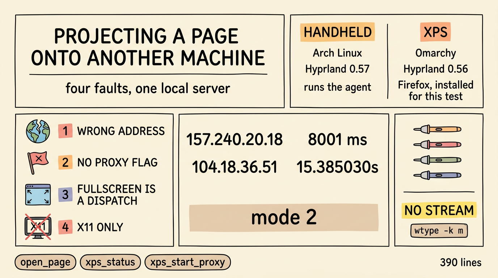
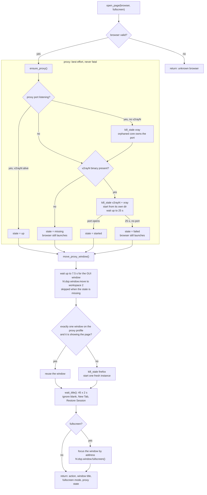

# Projecting a Page Onto Another Machine: a Local MCP Over SSH

*2026-11-10, updated 2026-11-17*

**Thesis:** "Open this page on the other laptop" is a one-line goal that turned into four separate faults, none of them about SSH. A local MCP server that hides them is 390 lines; finding them took a differential measurement at every step, and each answer invalidated the previous guess.

**Status:** verified end to end on both machines, with the proxy cold-start, the browser launch, the fullscreen dispatch and the missing-binary fallback exercised in the failing state rather than merely observed working.



## The goal

Two machines on one LAN. The handheld runs the agent; the laptop, `xps`, has the screen. The task: put `watch.plex.tv/live-tv` on that screen, in a browser, fullscreen, on demand.

| | handheld | `xps` |
|---|---|---|
| OS | Arch Linux | Omarchy (Arch-based) |
| Desktop | Hyprland 0.57 | Hyprland 0.56 |
| Browser | — | Firefox, installed for this test |
| Role | runs the agent | runs the proxy, the browser, the compositor |

The page is not the point; the network path is. `xps` runs a proxy that exits through one chosen VPN, and launching an app through that path is the test. Plex live TV is just the app that makes the requirement visible.

Carrying the handheld's session across was rejected first: Chromium-family browsers encrypt cookies with a key in the OS keyring, so a copied profile is undecryptable bytes unless the secret travels too — and then the second machine holds every Google session the first one has. Not worth one login. The laptop launches its own browser instead, and the login happens once, there.

## The four faults

Each one looked like the fault before it was measured.

### 1. The name resolves to the wrong address

The first launch produced a window that never loaded. Firewall, DNS, routing — none of them.

`watch.plex.tv` does not resolve to Plex. It came back as `157.240.20.18` when measured, `199.59.149.230` a week later; the real answer, from a public resolver, is `104.18.36.51`. The wrong answer moves, which is the tell: something other than the site's DNS is answering, so the page cannot load until traffic leaves through a tunnel.

That is the whole job, restated: not "open a URL" but "open a URL through a proxy".

The confirming measurement was a control group — the same request from both machines, before and after the proxy existed:

```
direct:            curl: (28) Connection timed out after 8001 milliseconds
through the proxy: 200 in 15.385030s
```

### 2. Firefox has no `--proxy-server`

There is no flag for it; proxy settings live in `prefs.js`. Two consequences, both of which bite:

- The setting has to be *written*, not passed. The server writes a dedicated profile's `user.js` on every call, which makes the configuration idempotent and keeps the proxy scoped to one profile instead of routing the whole browser through it.
- A running browser cannot be retrofitted. A second invocation only forwards the URL to the existing process, so the server restarts a browser that lacks the setting, reuses the window when exactly one already shows the page, and clears the leftovers when the window count has drifted.

The proxy also solves the DNS problem for free: with an HTTP proxy, the CONNECT carries a hostname and the name is resolved at the far end, so the poisoned local answer is never consulted.

### 3. Fullscreen is not a browser flag here

`--start-fullscreen` looked correct and did nothing. Under a tiling compositor, and especially when the launch is forwarded to a running instance, the flag is not applied to a new window.

Hyprland 0.56 also changed the dispatcher language. The old form is rejected outright:

```
$ hyprctl dispatch fullscreen 1
error: [string "return hl.dispatch(fullscreen 1)"]:1: ')' expected near '0'
```

Dispatchers are now Lua expressions, `hl.dsp.*`, and the numbering is not what it looks like: **mode 2 is fullscreen, mode 1 is only maximize.** Dispatching `1` maximises the window and reports `fullscreen = 1`, which is easy to read as success.

The working sequence focuses a specific window by address, then fullscreens it:

```sh
hyprctl dispatch "hl.dsp.focus({ window = \"address:$addr\" })"
hyprctl dispatch 'hl.dsp.window.fullscreen()'
```

Focusing by address matters: the target page sometimes opens a second window of its own — a sign-in step — and fullscreening "the active window" then lands on the wrong one.

### 4. v2rayN is X11-only

Starting the proxy on demand looked trivial and failed immediately:

```
Unhandled exception. System.Exception: XOpenDisplay failed
   at Avalonia.X11.AvaloniaX11Platform.Initialize(X11PlatformOptions options)
```

The Avalonia build of v2rayN has an X11 backend and nothing else, so it needs `DISPLAY`. An SSH session has none. Hyprland does not export `DISPLAY` into its own environment either, so reading it from the compositor returns nothing. And the fallback `:0` is worse than no display at all, because another X server exists there and answers:

```
Authorization required, but no authorization protocol specified
```

XWayland was on `:1`. The number changes across boots, so it is read from the Xwayland command line rather than assumed.

One more detail: v2rayN resolves `bin/` and `guiConfigs/` relative to its working directory, so it has to be started from its own directory, not by absolute path from `$HOME`.

## The fifth symptom: a silent page

Four faults, and the projection still was not finished. The page came up playing, in fullscreen, and mute: a speaker with a cross sat in the corner of the video. The obvious reading is that the laptop is muted, and it is wrong in a way that costs three rounds of troubleshooting.

A crossed-out speaker can come from one of four places, and each has its own command:

| Layer | Command | Reading | Verdict |
|---|---|---|---|
| sink mute | `pactl get-sink-mute @DEFAULT_SINK@` | `Mute: no` | not muted |
| sink volume | `pactl get-sink-volume @DEFAULT_SINK@` | `9830 / 15% / -49.44 dB`, both channels | quiet, not muted |
| hardware mixer | `amixer -c0 sget Master` | `Playback 22 [25%] [-48.75dB] [on]` | unmuted |
| **per-app stream** | `pactl list sink-inputs`, `wpctl status` → `Streams:` | **empty — no stream** | **the page never sent audio** |

The last row is the one that decides it. An empty `Streams:` means nothing was ever handed to the sink, so no change at the mixer or the ALSA layer could have produced sound. Raising the volume was the instinct, and it is wrong: a page that is not playing stays silent at any volume. The mute was a control *inside* the player — `grim` puts it inside the video frame, bottom-left, around `(141, 551)` on a 1920×1080 screen, which is a player control and not a desktop widget.

The fix is that control, and there is no pointer to click it with:

| Tool | Result on that host |
|---|---|
| `ydotool` / `dotool` / `xdotool` | not installed |
| `wtype` | installed — keyboard only, via the Wayland virtual-keyboard protocol |
| `/dev/uinput` | `crw------- root root` — `ydotool` would need root |

So the lever is the site's own keyboard shortcut. Plex web binds `m` to mute-toggle, and the three steps are the same shape as the fullscreen dispatch — discover the session, then act on a named window:

```sh
# an SSH login carries no session env: without this, hyprctl and wtype fail silently
RUNDIR="/run/user/$(id -u)"
WD=$(ls "$RUNDIR" | grep -m1 '^wayland-[0-9]*$')
HIS=$(ls "$RUNDIR/hypr" | head -1)
export XDG_RUNTIME_DIR="$RUNDIR" WAYLAND_DISPLAY="$WD" HYPRLAND_INSTANCE_SIGNATURE="$HIS"

# focus by address, never by title — titles change with the page
hyprctl dispatch "hl.dsp.focus({ window = \"address:0x55b4d64a01d0\" })"

wtype -k m
```

Focusing first is not politeness. Without it the keystroke lands on whatever holds focus — here the `v2rayN` window parked on its workspace — and the failure is completely silent.

Which is why the check is by effect, not by exit code:

```sh
pactl list sink-inputs | grep -E 'Sink Input|Mute:|application.name'
#   Sink Input #99 · Mute: no · Volume: 100% · application.name = "Firefox"
wpctl status | sed -n '/Audio/,/Video/p'
#   68. Firefox → output_FL / output_FR  [active]
```

`wtype` returns 0 whether or not the page listened. **The stream appearing is the proof.** Before the keypress there was no sink-input at all; after it, the hardware path was live.

The mute is re-asserted on every load, and the unmute dies at the next navigation. Measured: `Ctrl+R` on the just-unmuted page brought the crossed speaker back and left zero sink-inputs. Two mechanisms would produce that, and they were not separated — Plex's own default mute, and Firefox's default autoplay policy, which blocks audio until a user gesture and grants only a *temporary* permission that resets on navigation. That profile carries no autoplay override, and `permissions.sqlite` holds no autoplay grant for `watch.plex.tv`, which is consistent with the second and does not exclude the first. What is established is narrower and sufficient: the mute returns on its own, and one key event clears it for the session.

The other open item is the sink volume — 15% on the day, 25% when re-checked two days later — quiet enough after the unmute to look like a further fault. That is a separate decision, so it was reported and left alone.

Measured 2026-11-15, on a page projected minutes earlier.

## The design

The server exposes three tools, and deliberately no generic "run a command on the remote host" tool, which would be remote code execution behind an agent.

| Tool | Does |
|---|---|
| `open_page(browser, fullscreen)` | ensures the proxy, launches the browser on the configured URL, fullscreens the window |
| `xps_start_proxy()` | starts the proxy if its port is not listening |
| `xps_status()` | proxy state, browser process count, window titles |

Everything machine-specific is an environment variable with a sane default: the ssh destination, the URL, the proxy address, and the directory holding the proxy binary. The committed file therefore carries no address and no username; the one home-relative default is the proxy directory, and `XPS_V2RAY_DIR` overrides it.

The ssh destination defaults to an alias, not an address. On a LAN the address is usually a DHCP lease, so putting it in the alias keeps the churn in `~/.ssh/config`, where changing it is a one-line edit, instead of in Python.

The proxy start is **best effort**, not a precondition. If the port is down the server starts the binary and waits; if the binary is not there at all, it launches the browser anyway and says so. A projection helper that refuses to open a window because an unrelated daemon is missing is less useful than one that opens it and reports the truth.

### One call, end to end

Every branch below exists because one of the four faults broke the naive order: the proxy comes first and never blocks, the GUI is parked on its own workspace, the browser is reused only when it is already correct, and fullscreen is dispatched rather than passed.



## Setup

**The code here is reference, not homework.** Do not retype it: hand the server or the skill to your agent and let it do the work on your machine. The snippets are here so you can check what it did.

On the remote host: Hyprland with `hyprctl`, `jq`, `ss` from iproute2, and Firefox — installed for this test, so the proxy can live in its own profile and leave the machine's default Chromium alone. Optionally v2rayN, if the network needs it.

On the machine running the agent: `uv` and `ssh` with a key that already works. In `~/.ssh/config`:

```
Host xps
    HostName 10.0.0.42
    User you
    IdentityFile ~/.ssh/your_key
```

The server itself is one directory:

```
.opencode/mcp/xps-plex/
├── README.md
└── server.py
```

Registered in `opencode.jsonc`. The SDK is pulled at run time rather than installed, so nothing changes on the system Python:

```jsonc
"mcp": {
  "servers": {
    "xps-plex": {
      "type": "local",
      "command": [
        "uv", "run", "--with", "mcp",
        "/path/to/xps-plex/server.py"
      ],
      "environment": {
        "XPS_SSH_HOST": "xps",
        "XPS_PROXY_WORKSPACE": "2"
      }
    }
  }
}
```

V2 reads names only under `mcp.servers`; older docs show the bare `mcp.xps-plex` shape, which this schema does not define. The field for keeping a server configured without connecting it is `disabled`, not `enabled` — leave it out and the server connects.

MCP servers load at startup, so the client needs a restart before the tools appear.

Every machine-specific value is an environment variable in that block, with a default that works if you set none of them:

| Variable | Default | What it changes |
|---|---|---|
| `XPS_SSH_HOST` | `xps` | the ssh destination — an alias from `~/.ssh/config`, not an address |
| `XPS_URL` | `https://watch.plex.tv/live-tv` | the page to open |
| `XPS_PROXY_ADDR` | `127.0.0.1:10808` | the address the readiness check polls; it must match the profile's, which is what the browser uses |
| `XPS_V2RAY_DIR` | `$HOME/pool/Downloads/rog_drive/v2rayN-linux-64` | where the proxy binary lives |
| `XPS_PROXY_WORKSPACE` | `2` | the Hyprland workspace the proxy GUI is parked on |

## Using it

Three tools, and no fourth. Each is one call with at most two arguments, and none of them accepts a command to run.

| Call | Arguments | Returns |
|---|---|---|
| `open_page(browser, fullscreen)` | `browser` — `"firefox"` (default); `fullscreen` — `true` (default) | one line per step: what happened to the browser, the window title, the fullscreen mode, the proxy state, the workspace the proxy GUI was parked on |
| `xps_start_proxy()` | none | the proxy state on its own: `up`, `started`, `missing` or `failed` |
| `xps_status()` | none | host, proxy state, browser process count, and the window titles |

Both arguments are optional, so the ordinary call is the bare one:

```
open_page()
```

A cold run reports each part, including the ones that went well:

```
Firefox was not running; started on the proxy profile
window: Live TV Guide - Plex — Mozilla Firefox
fullscreen: mode 2
proxy: was down, v2rayN started
proxy window: workspace 2
```

The proxy fallback reports itself too, rather than failing:

```
window: Live TV Guide - Plex — Mozilla Firefox
fullscreen: mode 2
proxy: v2rayN not found, launched without it
```

Three behaviours are worth knowing before you call it twice.

**It is idempotent, and it cleans up after itself.** If the same profile already shows the page in exactly one window, the window is reused and nothing is relaunched. If it has drifted — two windows from earlier calls, a blank tab, a crash-restore dialog left by a killed browser — the browser is cleared and started once. Calling it in a loop does not pile up windows.

**Fullscreen is mode 2, and it is dispatched, not requested.** The window is focused by address first, so the sign-in popup the site sometimes opens cannot steal the fullscreen from the page you asked for.

**The proxy GUI is parked out of the way.** `v2rayN` is moved to the workspace named by `XPS_PROXY_WORKSPACE` (2 by default), silently, so the browser owns the visible workspace instead of sharing it with a proxy window.

Ask for it in the same words you would use to a person — the tool schema does the routing:

| Say | Reaches for |
|---|---|
| "open the Plex page on the laptop, fullscreen" | `open_page` |
| "is the proxy up, and is anything still open?" | `xps_status` |
| "start the proxy, I will open the page myself" | `xps_start_proxy` |

An agent that skips the status call and goes straight to `open_page` is not doing anything wrong: the server checks the proxy itself and reports what it found.

## The debugging trail

Every row is a measurement that overturned the previous assumption.

| Observed | Assumed | Actual |
|---|---|---|
| page never loads | firewall blocking 443 | the name resolves to someone else's address; only the proxy path works |
| `1.1.1.1:443` fails from the target | egress filtered on that host | the same target fails from the control host too; the target was simply unreachable |
| `--start-fullscreen` ignored | compositor quirk | forwarded launches never apply it; fullscreen belongs to the compositor |
| `hyprctl dispatch fullscreen 1` | valid dispatcher | Hyprland 0.56 takes Lua dispatchers, and `1` means maximize |
| `XOpenDisplay failed` | missing X server | v2rayN is X11-only and `DISPLAY` was never set |
| `DISPLAY` discovery empty | Hyprland exports it | it does not; XWayland's number must come from its command line |
| a crossed-out speaker on the page | the mixer was muted | the mixer was unmuted at 15%; no sink-input existed at all |
| the page played, the audio did not | Firefox autoplay policy blocking it | the mute is re-asserted on every load and does not survive a navigation; one key event (`m`) clears it for the session. Player-mute and the autoplay gate were never separated |

The `DISPLAY` discovery hid inside a Python string: a `sed` backreference written as `\1` in a non-raw string became the octal escape `U+0001`, so the regex silently matched nothing and the `:0` fallback returned. The compiler had already warned about it, twice, and the warning was ignored. A `SyntaxWarning` is a reading instruction.

## What this does not do

It does not move a browser session: the login lives in the dedicated profile on the remote machine, and the server never sees a credential.

It does not start the proxy if the binary is missing, and it does not verify that the page rendered. It waits for a window whose title is not a placeholder — a blank tab, `New Tab`, the crash-restore dialog — then reports what it found. Whether the right content sits behind that title is the caller's judgement.

It does not check that the page is audible. A launch can be complete — one window, fullscreen mode 2, the right URL — and still be mute inside the player, which no amount of status reporting will reveal. That has to be read off the screen, and fixed with the page's own controls.

It assumes one monitor and one compositor. Multiple outputs would need the dispatch to name a monitor.

## Files

The server and its README: [`ai-thoughts/.opencode/mcp/xps-plex`](https://github.com/j3ffyang/ai-thoughts/tree/main/.opencode/mcp/xps-plex).

The skill that does the same job, with the same script logic and no process: [`ai-thoughts/.opencode/skills/xps-plex`](https://github.com/j3ffyang/ai-thoughts/tree/main/.opencode/skills/xps-plex).

Which of the two to reach for, and why both exist: [A Skill or an MCP Server?](https://github.com/j3ffyang/ai-thoughts/blob/main/docs/261111-skill-vs-mcp.md).

btw, i use arch
