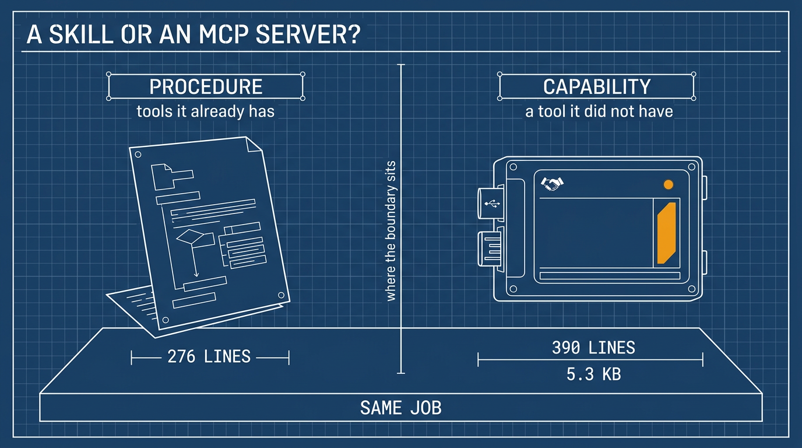

# A Skill or an MCP Server? Two Ways to Give an Agent a Trick

*2026-11-11*

**Thesis:** they are not two answers to one question. **A skill teaches the agent a procedure it can run with the tools it already has; an MCP server gives it a tool it did not have.** Mixing the two up makes both feel arbitrary — you end up writing a server when a paragraph would do, or a paragraph when a tool was needed.

**Status:** both built. The same job — put a Plex page fullscreen on a second laptop over SSH — now exists as an MCP server and as a skill, and every claim below is grounded in that pair rather than argued in the abstract. The server is described in [the projection article](https://github.com/j3ffyang/ai-thoughts/blob/main/docs/261110-projecting-a-page-onto-another-machine.md).



## What this was for

The second machine (`xps`) runs Omarchy — an opinionated Arch with Hyprland on top — so the fullscreen calls in both versions are Hyprland dispatches, and the mode numbers are Hyprland's own.

Omarchy's default browser is Chromium, the open-source project Chrome is built from, so Firefox had to be installed on purpose. Both the server and the skill drive Firefox or Brave and nothing else, and Firefox is the default because its proxy lives in a dedicated profile's `user.js` rather than a launch flag: one file, rewritten on every call, scoped to that profile and nothing else. The default browser is never touched.

That machine also runs a proxy that exits through one chosen VPN. That is not a workaround bolted on for the demo; it is the thing under test. The exercise is to launch an app on a specific network path and see how it behaves there, and Plex live TV is the case that makes the requirement visible: on this network the name resolves to an address that is not Plex, so a page opened without the proxy loads nothing at all.

So the job was narrow and concrete: from this laptop, put a Plex page fullscreen on that one, over SSH, and find out whether the MCP server or the skill is the better way to do it. On this job the two are nearly the same thing — same three actions, same script logic, the same fields — and that is exactly why the comparison is worth making. What differs is not what gets done. It is where the boundary sits.

## The confusion, stated plainly

Both make the agent "able to do something new". From the outside that looks like a choice between two implementations of one feature, and the honest first reaction is: why would anyone write 390 lines of Python when a markdown file does the same thing?

The answer is that they do not sit at the same level.

|  | SKILL.md | MCP server |
|---|---|---|
| What it adds | a **procedure** — how to use existing tools | a **capability** — a new tool the client did not have |
| What runs | the agent's own tools: `bash`, `ssh`, a script you shipped | a process the client starts, speaking JSON-RPC |
| What must be true | the caller has a shell | the caller is an MCP client |

A recipe card tells a cook what to do with the pots in the kitchen. A new appliance adds a way to cook that the kitchen did not have. Both put dinner on the table, and only one of them needs a power socket.

## The same job, two shapes

The MCP version:

```
.opencode/mcp/xps-plex/
├── server.py           15.5 KB, three tools
└── README.md           5.3 KB
```

One server per client instance, spawned at startup from OpenCode's config:

```jsonc
"mcp": {
  "servers": {
    "xps-plex": {
      "type": "local",
      "command": ["uv", "run", "--with", "mcp", "/path/to/server.py"],
      "enabled": true
    }
  }
}
```

The skill version is a directory of prose and one script:

```
.opencode/skills/xps-plex/
├── SKILL.md              when to use it, the arguments, the four faults it dodges
└── scripts/xps-plex.sh   the same logic, callable by hand
```

No process. No registration. No runtime beyond the shell the agent already has.

## What the model actually sees

This is the part that decides everything else.

**With a skill**, the model sees the name and the description — and nothing more until it decides the skill is relevant. That description is not a line; it is the whole price of the skill, paid on every turn:

```
name: xps-plex
description: >
  Project a web page fullscreen onto the second laptop (ssh host `xps`) over
  SSH: start the v2rayN proxy if it is down, launch Firefox or Brave on a
  dedicated proxy profile, park the proxy GUI on its own workspace, fullscreen
  the page. … Use when the user asks to put a page, a stream, or Plex live TV
  on the other machine's screen, …
```

121 words for this one. Across the skills in this repo — about twenty of them — the always-on descriptions total a little over 1,400 words, roughly two thousand tokens before a single body is loaded. That is cheap, and it stops being cheap the moment every description grows into a paragraph.

Then it loads the body, reads your procedure, and does the work by calling the tools it already had. `ssh`, `bash`, `magick` — whatever the procedure asks for. If the body says "run `scripts/xps-plex.sh open --browser firefox`", the result is deterministic. If the body is prose with no script, the model composes the shell itself each time, and that is exactly where behaviour drifts.

**With an MCP server**, the model sees the tool list with typed arguments:

```
xps_status()
open_page(browser: string = "firefox", fullscreen: boolean = true)
xps_start_proxy()
```

No shell is involved on the model's side. The client spawns the process, asks `tools/list`, and calls by name. `browser: "chrome"` is refused rather than guessed at — but not by MCP, which knows nothing about browsers, and not by the schema, which still types the argument as a plain string. The same `case` check sits in the skill's script and exits 2 on the same input: Firefox is the standard here, and the refusal enforces it. Chrome is left out by policy, not by impossibility — wiring it to the same discipline would be fine.

So what the typed surface actually buys is *when* the refusal happens. A `Literal["firefox", "brave"]` lets the client reject the call before anything runs; the script can only refuse after being asked.

The interface has a cost you can see. This is what "call the server" actually looks like underneath:

```json
{"jsonrpc":"2.0","id":1,"method":"initialize","params":{…}}
{"jsonrpc":"2.0","method":"notifications/initialized"}
{"jsonrpc":"2.0","id":2,"method":"tools/list"}
```

Five messages before the first tool call — those three requests and the two responses between them — and a handshake to debug whenever the tool does not appear.

## Where each one wins

| | SKILL.md | MCP server |
|---|---|---|
| **Creation** | one file, minutes. `resize-for-banner` is 4.8 KB and was written in a sitting | a program, a transport, a README, and a config entry — hours |
| **Simplicity** | editable prose; the logic is readable by anyone | readable code, but the interface is a protocol; debugging means building frames by hand |
| **Effectiveness** | deterministic when it ships a script, and only then — prose alone is a suggestion the model re-interprets every time | the same call every time, with argument validation at the boundary — though on this pair the logic was shell either way, so reliability did not move |
| **Operation** | nothing to start, nothing to crash, no process, no port | one server per client instance, spawned at startup, restarted after every edit |
| **Management** | files under `skills.paths`; publishable as a file; about twenty of them live in this repo | an entry in every client's config on every machine, in the shape that client's own docs may have deprecated; today that cost one write into the global config when the project one was meant |
| **Maintenance** | edit and save; the next session reads it | edit and restart the client — six edits of the server, and the running session saw none of them without one |
| **Context cost** | name and description always, body only on use — scales to dozens as long as descriptions stay short | every tool schema is in the tool list whenever the client is connected — these three serialize to 1.4 KB of JSON, about four hundred tokens |
| **Safety surface** | needs `bash` or `terminal`; once it has a shell, the skill cannot constrain the command — only the harness can, and only by pattern | three narrow tools cannot be talked into `rm -rf` |
| **Team use** | easy to share, but each teammate's agent re-reads and re-interprets it | one reviewed artifact deployed from a central copy — the same behaviour for everyone, and one trust decision instead of N |

## The four questions that decide it

1. **Does the caller have a shell?** If yes, a skill can drive anything — `ssh`, `git`, ImageMagick. If no, only a typed surface can act, and that is not a preference: it is the only door.
2. **One client or many?** A skill is one file any agent that implements the convention can read — and the conventions differ across clients. An MCP server is registered per client, per machine, and again when it moves.
3. **Who edits it next?** Prose can be corrected mid-thought. Code with an interface drags its callers along when it changes.
4. **How narrow must the capability be?** For an agent you do not fully trust, a three-tool server is a much smaller promise than `bash`.

## What the build measured

The server's logic is almost entirely shell. `ensure_proxy`, the orphaned `xray` core, the window-count test, the workspace move — all of it is `ssh … bash -s`, with Python only carrying the string. Wrapping it in MCP added a process per client — two in this build, because the launch line is `uv run`, which wraps the interpreter it spawns — a protocol, a config entry, and six restarts; it did not make the work more reliable.

What it did make possible is a client without a shell calling `open_page()`. That is the whole return on the investment, and it is worth it only if that client exists.

It does not exist yet. The client in front of me — OpenCode — has a shell, so every one of these three tools can be done by the skill, and the skill is the one I reach for. The server was worth building once, to learn what the protocol actually costs and to have the other half of this comparison. It is not worth building a second one for the same reason.

The skill shape carries the same logic as a 276-line bash script, with none of the ceremony, and it is runnable by hand, which matters more than it sounds: the fastest way to debug today's window logic was to run the commands directly, not to speak JSON-RPC at a subprocess. The prose in front of it is about 140 lines. The server needed 390 lines of Python, a 5.3 KB README, a runtime, and six restarts; the skill needed the script and a restart-free save.

And that is where this pair breaks its own rule. The server does not call the skill's script; it carries its own copy of the same bash inside its heredocs. The rule below says to wrap the script. What I actually built was two copies of it, and keeping them in step is the part of this pair I would not repeat — the next server starts as a thin `subprocess.run` around `scripts/xps-plex.sh`, with a schema in front.

## The rule

> Write the logic as a **script** first — runnable by hand, testable, no runtime. Put a **SKILL.md** in front of it that says when to call it and with what. Wrap that same script in an **MCP server** only when a shell-less client needs it, or when several clients must share one typed surface.

The ratio in this repo is about twenty skills to two servers, and that is roughly what the rule predicts: skills are the default, servers are the exception with a reason.

## What does not change

A skill is an instruction boundary. A clever page can talk the model into a different procedure than the one you wrote, because the model is the interpreter.

An MCP server is a capability boundary. There is no prose to bend: the tool does what it does, and the arguments are checked. It still cannot make a bad decision safe if the tool itself is too broad — which is why the projection server exposes `open_page` and not "run a command on the host".

## What "more secure" does and does not mean

The intuition that an MCP server is the safer of the two is right, but the reason usually given for it is not. Packaging everything into one server is a deployment convenience — one config entry, one process, one README — not a security gain. That process holds the union of everything its tools need: environment, files, network. Every tool it exposes is reachable by the agent. Three narrow tools in one server are still three narrow tools; twenty in one is a bigger trust decision, not a smaller one.

The control comes from two things only: each tool staying narrow, and the client being able to allow or deny tools one at a time. It disappears the moment a tool accepts a free-form command — at that point you have rebuilt `bash` with a protocol in front, and the safety claim goes with it.

For a team the case for MCP is real, but it is a case about the contract rather than the protocol. One reviewed, versioned artifact with a typed surface, deployed from a central copy, gives every teammate the same behaviour and the same narrow options, and it cannot be re-interpreted into a different procedure on a Tuesday. Security is the byproduct: a fixed surface is reviewed once and then trusted by everyone. The cost sits on the other side of the ledger — every teammate runs that code locally with their own permissions, a supply-chain surface a markdown file does not have. So MCP is the better team default when the tools stay narrow and the server has an owner. When the team already has shells and the thing to share is a procedure, a skill plus a reviewed script shares it more cheaply, and the shell is a risk that was already accepted.

Neither is a sandbox. Both assume you decided what the agent may do before you handed it the ability.

btw, i use arch
