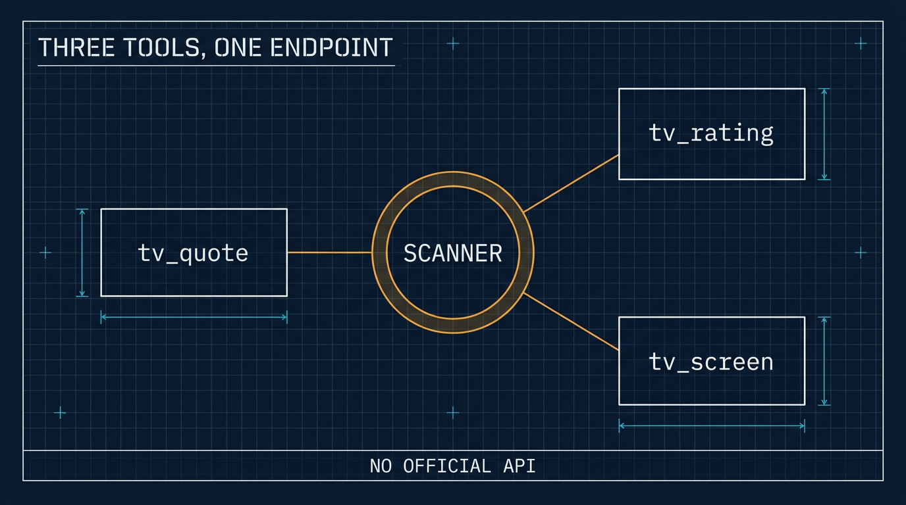

# A TradingView MCP: Three Tools Over an Endpoint Nobody Documents

*2026-11-11*

**Thesis:** **TradingView** publishes no API, so every TradingView tool is built on the endpoints its own web app uses. Wrapping one in an MCP is small work; the work is discovering which of its answers are quietly wrong.

**Status:** running on both — **◧ OpenCode** locally and the **⚕ Hermes** bot — three read-only tools, verified against live data on each.

## Why this exists

I wanted the agent to answer "what is NVDA doing right now" without me opening a chart. TradingView is where that answer lives, and TradingView has no official API — no key, no documented endpoint, no developer programme. What exists is a set of endpoints the site itself calls, and a handful of libraries that talk to them.

The libraries are not equivalent, and the difference is maintenance:

| Library | Last release | Verdict |
|---|---|---|
| `tradingview-screener` | 2026-09 | maintained; drives the scanner endpoint |
| `tradingview-ta` | 2022 | stale, and its ratings are already scanner fields |
| `tradingview-scraper` | 2026-09 | scrapes chart data, more fragile |
| `pyTradingView` | 2026-02 | websocket client, more moving parts |

One library covers it. The scanner returns quotes, technical ratings *and* screening, which is everything I actually wanted — no chart drawing, no websocket, no cookies.

## Three tools

| Tool | Arguments | Answers |
|---|---|---|
| `tv_quote` | symbols, market | price, change, volume, market cap, rating |
| `tv_rating` | symbol, interval, market | overall rating split into moving averages and oscillators |
| `tv_screen` | filters, market, limit, sort | "find me stocks where…" |

```
NASDAQ:AAPL  AAPL  348.51  -0.62  29,756,060  5.06T  0.26
NASDAQ:NVDA  NVDA  168.89  -5.47  429,273,195  4.07T  -0.51
```

Symbols work bare: `AAPL` resolves to `NASDAQ:AAPL`, `BTC` to `BINANCE:BTCUSDT`.

A rating runs −1 to +1. What makes it worth printing side by side is that the three columns disagree: NVDA at one point read `overall −0.51, moving averages −0.93, oscillators −0.09` — the trend is down, the momentum has stopped falling. A single number hides that.



## Three things the first version got wrong

**Chained filters overwrite each other.** A screen asking for `RSI < 25` returned AAPL at RSI 55. The client's `where()` replaces the filter rather than adding to it, so only the last condition survived; passing them as `where(*conditions)` ANDs them. The lesson generalises: a query builder that quietly keeps one condition produces plausible, wrong results — no error, just the wrong list.

**`type == "stock"` does not mean common stock.** Preferred shares such as `BAC/PE` and `MS/PA` report `type: stock`, and they dominated an oversold screen because preferreds trade thin and fall fast. The discriminating field is `typespecs`, so stock screens now add `typespecs has 'common'` unless you filter on it yourself, and the table says so underneath.

**Numbers are not presentation.** The scanner returns `-0.6216316404801981`. Rounding at the edge, grouping thousands, and writing market caps as `5.06T` is the difference between a table a person reads and a dump.

## Why an MCP and not a skill

The same question came up for the projection tool, and the answer is [in the other piece](https://github.com/j3ffyang/ai-thoughts/blob/main/docs/261111-skill-vs-mcp.md): a skill teaches a procedure, an MCP adds a capability. Here the deciding factor is the filter grammar. `tv_screen` takes JSON with fields, operators, `between`, and `has` — as a tool schema that grammar arrives with the call and a bad field is rejected in words the model can act on. Prose in a skill would drift the first time I added a field.

The cost is honest: the three tool definitions sit in context permanently, about 670 tokens. For a tool used in most trading conversations that is cheap.

## Registering it

Locally, OpenCode reads `mcp.servers.<name>` from its config. Two traps, both hit:

- The flat `mcp.<name>` form still works and is marked deprecated in the schema; mixing both shapes in one file is how you end up debugging the copy that does nothing.
- After editing the config, `opencode mcp list` read the **background service's** cached state and showed the old server list. The file was right the whole time. Restart the service, or check with `opencode debug config`, before believing a missing server.

On the Hermes VPS the shape is different: `hermes mcp add <name> --command … --args …`, which connects, lists the tools, and asks whether to enable them — non-interactively it cancels at that prompt, so pipe `y` or add the tools afterwards.

The host had no `uv` and no `ensurepip`, so the server lives in its own venv under `~/.hermes/mcp/tradingview/` with pip bootstrapped into that one directory. Nothing was installed system-wide.

## What enabling it on a bot actually means

Hermes exposes each MCP server as a toolset — `mcp-tradingview` — and a platform gets a list of toolsets. Adding it to `platform_toolsets.discord` gives it to **everyone in the channel**, because Hermes configures tools per platform, never per user. There is no way to hand it to one member.

That is fine here: the tools read a scanner and write nothing. It does mean each member's question spends model tokens on my account. Worth knowing before adding the next toolset.

## What it does not do

No chart data — candles belong to another endpoint and a different library, and this answers "what is it doing now", not "draw me a chart". No watchlists, alerts, or ideas: those need a logged-in session, and cookies in a config file are another risk class. Nothing writes.

And the honest constraint: this is unofficial tooling against endpoints TradingView can change any morning. The data is theirs, the queries are for personal use, and nothing here should be redistributed.

## The files

- GitHub: [tradingview MCP](https://github.com/j3ffyang/ai-thoughts/tree/main/.opencode/mcp/tradingview) — `server.py` and its README.

The lesson is not about TradingView. Any service without a documented API still has a shape, and the work is finding where that shape lies to you quietly.

btw, i use arch
